# AI Research Gap Agent — Harness, Tool Calling, Policy, Contract, KM, Decision Model และ Langfuse

2026-11-20

ภาพโค้ดทุกภาพ render จากไฟล์จริงใน D:\NLP_mini_project\ai_research_gap_agent (branch main, commit 801553a) เลขบรรทัดทางซ้ายคือเลขบรรทัดจริงในไฟล์ บรรทัดที่ยาวเกิน 110 ตัวอักษรถูกตัดท้ายด้วย … ส่วนภาพหน้าจอถ่ายจาก run จริงเมื่อ 2026-11-20 19:24

## 1. Harness ทั้งหมดในโปรเจกต์

Harness ในโปรเจกต์นี้คือโค้ดที่ห่อ LLM ไว้: ส่ง tool ให้ LLM เลือก, ตรวจ argument, บังคับ policy, รัน tool จริง, คืน context และตัดสินผลเองแทน LLM คำว่า harness ใช้ในโค้ดตรง ๆ ที่ llm_client.py:364 ("Tool calling (the agent harness)") และ README หัวข้อ "Tool calling (the agent harness)"

| \#  | ส่วนของ harness                     | อยู่ที่                                                                 | ทำอะไร                                                                                         |
|-----|------------------------------------|---------------------------------------------------------------------|------------------------------------------------------------------------------------------------|
| 1   | Tool-use loop                      | `llm_client.run_tool_loop` (399), `_run_tool_loop` (415)            | วนให้ LLM เรียก tool จนกว่าจะตอบโดยไม่เรียก tool หรือครบ `MAX_TOOL_STEPS` (8) แล้วบังคับให้ตอบ (451-456) |
| 2   | นิยาม tool                          | `tools._spec` (31), `SEARCH_PAPERS_SPEC` ฯลฯ (39-66)                | ชื่อ + คำอธิบาย + JSON schema ที่สร้างจาก pydantic contract                                          |
| 3   | Executor + policy ของ search agent | `tools.SearchToolContext` (148)                                     | ตรวจ argument, จำกัดแหล่งและปี, งบ call, รัน connector, scrub privacy, คืน context                  |
| 4   | Executor ของ verifier agent        | `tools.VerifierToolContext` (226)                                   | อ่านเนื้อหา paper / ค้น chunk จาก RAG เฉพาะ paper ที่วิเคราะห์แล้ว                                      |
| 5   | ซ่อมและตรวจ argument                | `tools.repair_arguments` (97), `_validate` (135)                    | ซ่อมสิ่งที่เจตนาชัด (เลขเกินช่วง, สตริงเป็นตัวเลข) ส่วนที่ผิดจริงคืนเป็น error ให้ LLM แก้                         |
| 6   | Harness fallback                   | `nodes.search_sources` (132-145)                                    | ถ้า LLM ไม่เรียก tool เลย harness รันคำค้นที่วางไว้เอง และติดป้าย `harness_fallback`                     |
| 7   | JSON contract re-ask               | `llm_client.call_json` (157)                                        | JSON ผิดหรือผิด contract → ถามซ้ำพร้อม error สูงสุด 3 ครั้ง                                             |
| 8   | ตรวจ quote                         | `nodes._quote_verified` (41)                                        | ตรวจว่า quote ที่ LLM อ้างมีอยู่จริงในข้อความที่เห็น                                                       |
| 9   | Verdict โดยโค้ด                     | `nodes.verifier_decision` (473)                                     | LLM รายงาน facts โค้ดตัดสิน supported/refuted                                                     |
| 10  | กฎวนและหยุดระดับ graph               | `nodes.route_after_sufficiency` (218), `token_budget_used_up` (213) | retry/extract ตาม `MAX_RETRY_LOOPS` และ `MAX_RUN_TOKENS`                                       |
| 11  | Outbound contract                  | `outbound.enforce` (53)                                             | ไม่ให้ PII หรือ API key ออกจากโปรเซส                                                              |

รูป 1-1: คำอธิบาย harness ในโค้ด (llm_client.py:364-378)

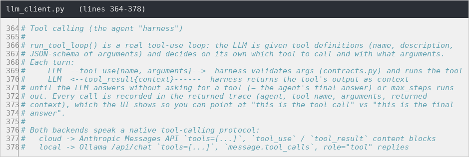

รูป 1-2: ตัววน tool-use loop (llm_client.py:415-456) ทุก tool call ถูกห่อด้วย `tracing.observe` และบันทึก agent, step, tool name, arguments และ context ที่คืนไป

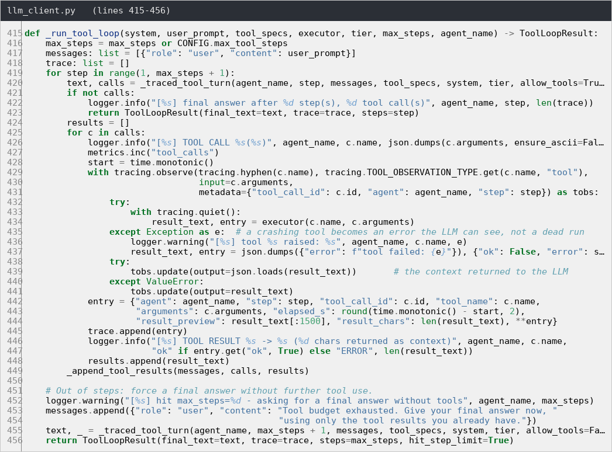

## 2. Harness ที่มี tool calling จริง

มี 2 agent ที่ใช้ native tool calling: LLM เป็นฝ่ายเลือกชื่อ tool และ argument เอง ไม่ใช่ MCP แต่เป็น tool ที่ส่งผ่านพารามิเตอร์ `tools=[...]` ของ API โดยตรง (โปรเจกต์มี `mcp_server.py` ที่เปิด `search_papers` และ `get_paper` เป็น MCP แยกต่างหาก แต่ agent ใน graph ไม่ได้เรียกผ่าน MCP)

| Agent (node)            | Tool                  | Arguments ที่ LLM เลือก                                                                        | Contract ของ argument                      |
|-------------------------|-----------------------|---------------------------------------------------------------------------------------------|--------------------------------------------|
| search_agent (node 2)   | `search_papers`       | query, source (semantic_scholar / arxiv / openalex / all), year_from, year_to, limit (1–50) | `SearchPapersArgs` (contracts.py:162)      |
| verifier_agent (node 7) | `get_paper_text`      | paper_id                                                                                    | `GetPaperTextArgs` (contracts.py:176)      |
| verifier_agent (node 7) | `search_paper_chunks` | paper_id, query, k (1–8)                                                                    | `SearchPaperChunksArgs` (contracts.py:184) |
| verifier_agent (node 7) | `search_corpus`       | query, k (1–10), scope (this_run / knowledge_base)                                          | `SearchCorpusArgs` (contracts.py:190)      |

โปรโตคอลที่ใช้จริง: backend local ส่ง `tools` ไป `/api/chat` ของ Ollama แล้วอ่าน `message.tool_calls` (llm_client.py:526-570) ส่วน backend cloud ส่ง `tools` ไป Anthropic Messages API แล้วอ่าน block `tool_use` และตอบกลับด้วย `tool_result` (llm_client.py:503-524)

ตัวอย่างจริงจาก run 2026-11-20 19:24 (`tool_trace` ใน output/20261120_193211_state.json) มี tool call 16 ครั้ง: `search_papers` 5, `search_paper_chunks` 8, `search_corpus` 3

``` json
// call #1 — agent=search_agent, tool=search_papers
{"query": "large language models in code review automation", "source": "all", "limit": 20, "year_from": 2020, "year_to": 2026}
// context ที่ harness คืน (ตัดมาบางส่วน)
{"query": "large language models in code review automation", "sources": ["semantic_scholar", "arxiv", "openalex"], "year_range": [2020, 2026], "n_results": 34, "n_new_unique": 34, "total_unique_so_far": 34, "calls_left": 9, "papers": [{"id": "arxiv:2507.18476v1", "title": "Automated Code Review Using Large Language Models with Symbolic Reasoning", "year": 2025, "citations": 8, "has_pdf": true}, ...]}

// call #8 — agent=verifier_agent, tool=search_corpus
{"query": "integration of symbolic reasoning with knowledge-based systems in code review automation", "scope": "this_run", "k": 5}
```

รูป 2-1: tool spec สร้างจาก pydantic contract (tools.py:31-45)

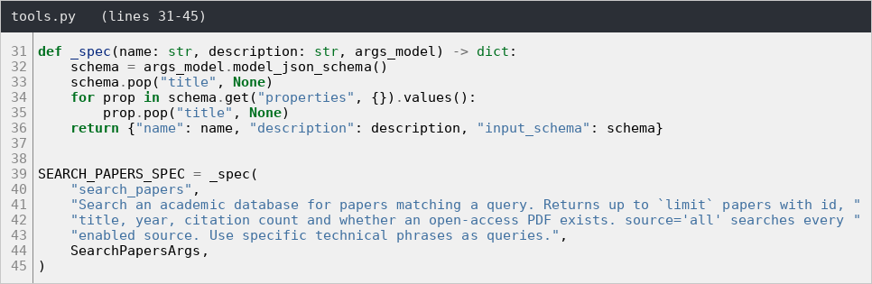

รูป 2-2: ส่ง tools ไป Ollama (llm_client.py:526-536)

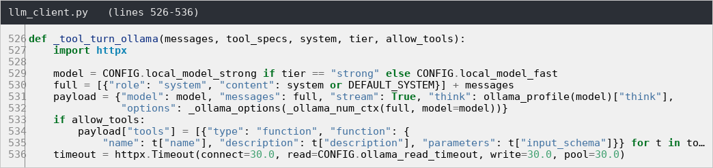

รูป 2-3: อ่าน `tool_use` จาก Anthropic (llm_client.py:503-524)

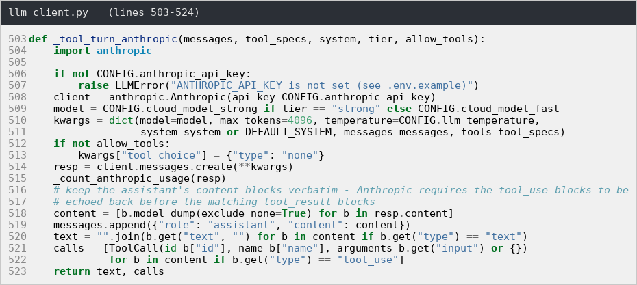

รูป 2-4: node 2 เรียก search agent พร้อม harness fallback (nodes.py:112-145)

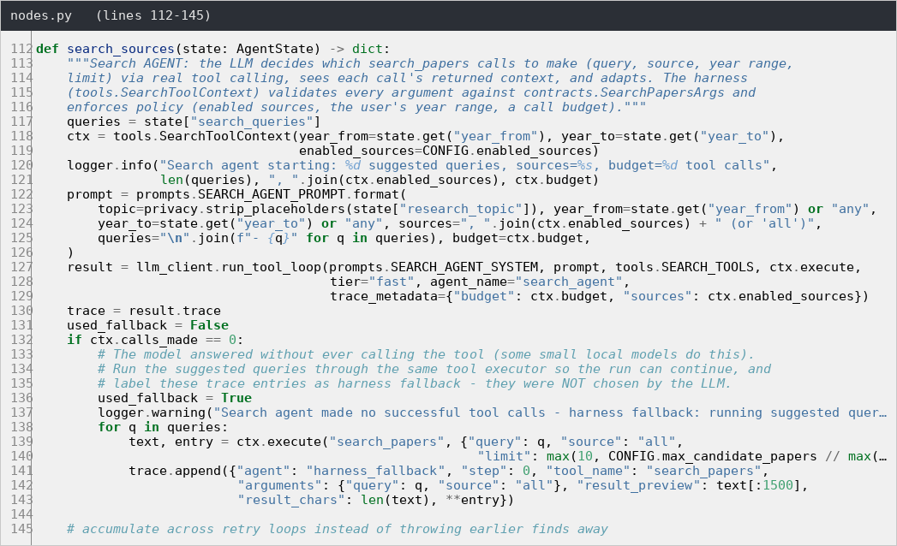

## 3. External: ฐานข้อมูลและระบบภายนอก

ระบบคุยกับภายนอก 9 จุด ทุก request ไปแหล่งเปเปอร์ผ่าน `sources/net.get` ที่เดียว ซึ่ง throttle ต่อแหล่ง retry 429/5xx และปิดแหล่งที่ล้มติดกัน 3 ครั้ง

| ระบบภายนอก                                                      | ประเภท                 | จุดเชื่อมในโค้ด                                                                              | ใช้ทำอะไร                                     |
|-----------------------------------------------------------------|------------------------|------------------------------------------------------------------------------------------|----------------------------------------------|
| Semantic Scholar Graph API (`api.semanticscholar.org/graph/v1`) | REST API               | sources/semantic_scholar.py:9, header `x-api-key`                                        | ค้น paper + metadata + open-access PDF        |
| arXiv API (`export.arxiv.org/api/query`)                        | REST (Atom XML)        | sources/arxiv.py:17                                                                      | ค้น paper                                     |
| OpenAlex (`api.openalex.org/works`)                             | REST API               | sources/openalex.py:10, พารามิเตอร์ `api_key`                                              | ค้น paper และสร้าง abstract จาก inverted index |
| เว็บที่เก็บ PDF open-access                                         | HTTP download          | sources/pdf_extract.py:91                                                                | ดาวน์โหลด PDF แล้วแปลงเป็น Markdown             |
| Ollama (`http://localhost:11434`)                               | LLM + embedding server | llm_client.\_call_ollama (235), `_tool_turn_ollama` (526), embeddings.py:94 `/api/embed` | qwen3:14b และ embeddinggemma:300m            |
| Anthropic Messages API                                          | LLM cloud              | llm_client.\_call_anthropic (207), `_tool_turn_anthropic` (503)                          | backend cloud (ไม่ได้ใช้ใน run ที่ถ่ายรูป)          |
| SQLite `rag_store/store.sqlite`                                 | ฐานข้อมูล local          | rag_store.py:99-115                                                                      | KM: ตาราง papers, chunks, extracts           |
| Langfuse self-hosted (`http://localhost:3000`)                  | observability          | tracing.py:66-92                                                                         | เก็บ trace ทุก run                             |
| Crossref + OpenAlex                                             | REST API               | evaluation/eval_citations.py                                                             | ใช้เฉพาะ script ประเมิน ตรวจ title/ปี/DOI       |

ไฟล์ที่เก็บบนดิสก์: `pdf_cache/` (เนื้อหา PDF ที่ redact แล้ว) และ `output/` (report + state JSON) ส่วน `UNPAYWALL_EMAIL` มีใน config.py:129 แต่ไม่พบจุดเรียก Unpaywall ในโค้ด (README เขียนไว้ว่าเป็นงานที่ทำต่อได้)

รูป 3-1: throttle ต่อแหล่งและสถานะที่นับ retry (sources/net.py:24-35)

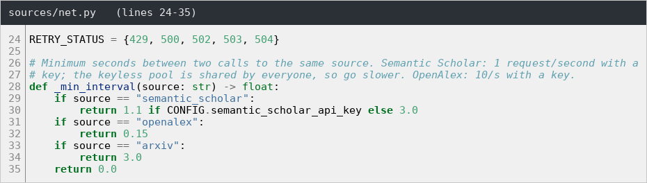

รูป 3-2: endpoint และพารามิเตอร์ของ OpenAlex (sources/openalex.py:10-22)

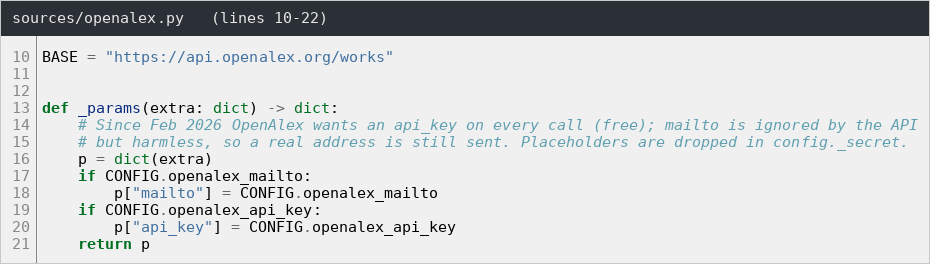

## 4. หน้าจอใช้งาน และส่วนไหนคืออะไร

ตัวเลขบนกรอบในแต่ละรูปตรงกับรายการใต้รูป ทุกรูปถ่ายจากแอป Streamlit (`streamlit run app.py`) และ Langfuse ที่รันอยู่จริง

รูป 4-1: หน้า Run agent ก่อนกดรัน

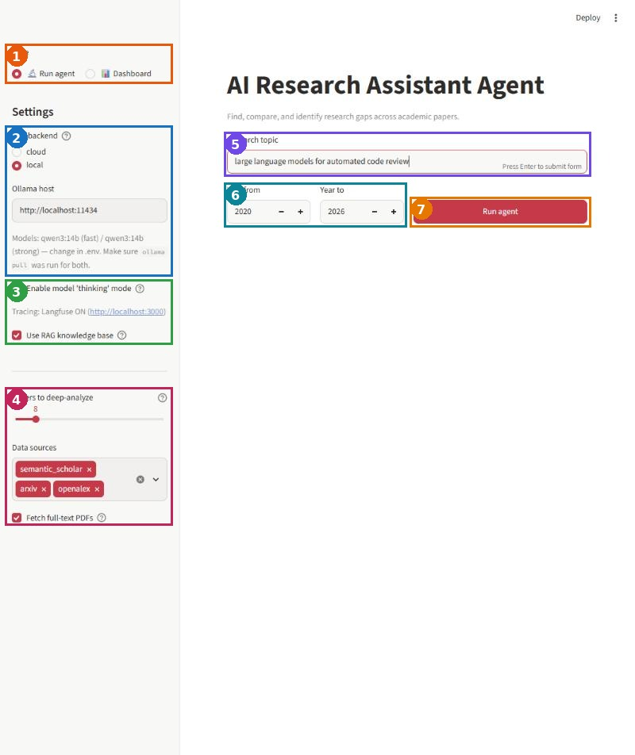

1.  สลับหน้า Run agent / Dashboard (app.py:276)

2.  เลือก LLM backend, Ollama host และโมเดลที่ใช้ (qwen3:14b ทั้ง fast และ strong)

3.  Thinking mode, สถานะ Langfuse ("Tracing: Langfuse ON") และเปิด/ปิด RAG knowledge base

4.  ค่าที่ harness ใช้เป็น policy: จำนวน paper ที่วิเคราะห์, แหล่งที่อนุญาต และการดึง PDF ฉบับเต็ม

5.  หัวข้อวิจัย ซึ่งจะผ่าน privacy (node 0) ก่อนส่งต่อ

6.  ช่วงปี ซึ่ง harness ใช้ clamp argument ของ `search_papers`

7.  ปุ่มเริ่มรัน graph

รูป 4-2: step card ระหว่างรัน

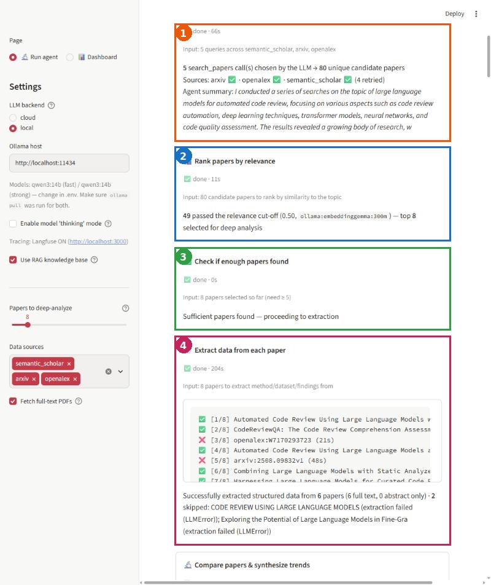

1.  Search agent: จำนวน `search_papers` call ที่ LLM เลือก, จำนวน candidate และสถานะแต่ละแหล่ง (External)

2.  Rank papers: cut-off 0.50 ของ embeddinggemma:300m

3.  Check sufficiency: decision rule ที่ตัดสิน retry หรือ extract

4.  Extract: สกัดต่อ paper พร้อม paper ที่ถูกข้ามและเหตุผล

รูป 4-3: Search scope

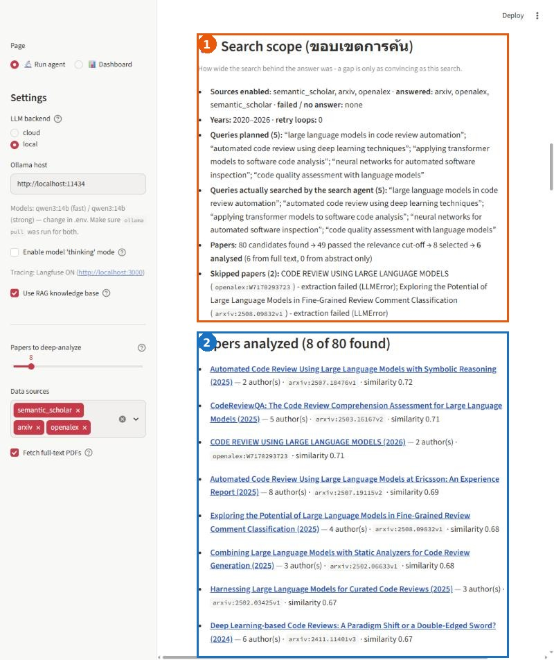

1.  ขอบเขตการค้น (`evidence.search_scope`): แหล่ง, คำค้น, ช่วงปี, จำนวน paper, full text/abstract, paper ที่ข้าม

2.  รายการ paper ที่เลือก ลิงก์สร้างจาก metadata (links.py) พร้อม similarity

รูป 4-4: Final answer

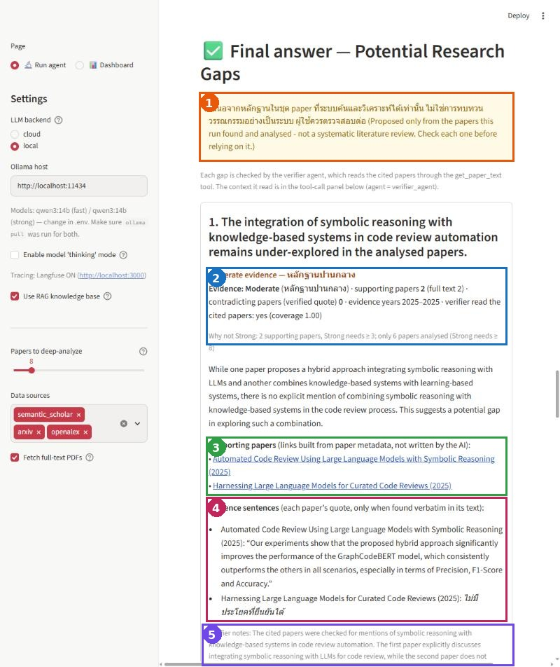

1.  ประโยคข้อจำกัด (ไม่ใช่ systematic review)

2.  ระดับหลักฐานจาก decision rule (`evidence.evidence_level`) พร้อมค่าที่นับได้และเหตุผลว่าทำไมไม่ได้ Strong

3.  Paper ที่สนับสนุน ลิงก์จาก metadata ไม่ใช่จาก LLM

4.  ประโยคหลักฐาน เฉพาะที่ผ่านการตรวจ quote (contract)

5.  Verifier notes จาก verifier agent

รูป 4-5: Tool calls

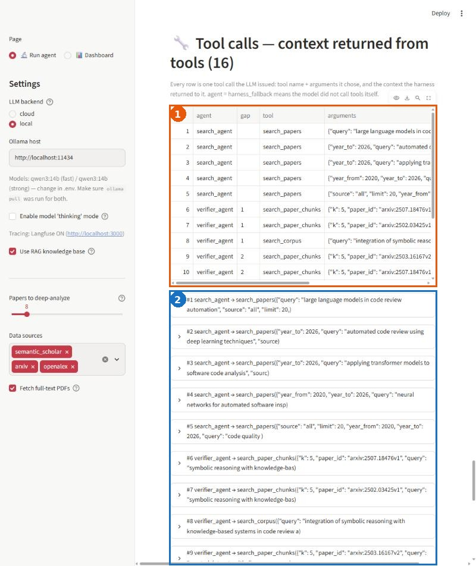

1.  ตารางทุก tool call: agent, gap, tool name, arguments

2.  กดแต่ละแถวดู argument ที่ LLM เลือกและ context ที่ harness คืนไป

รูป 4-6: Privacy, KM, metrics

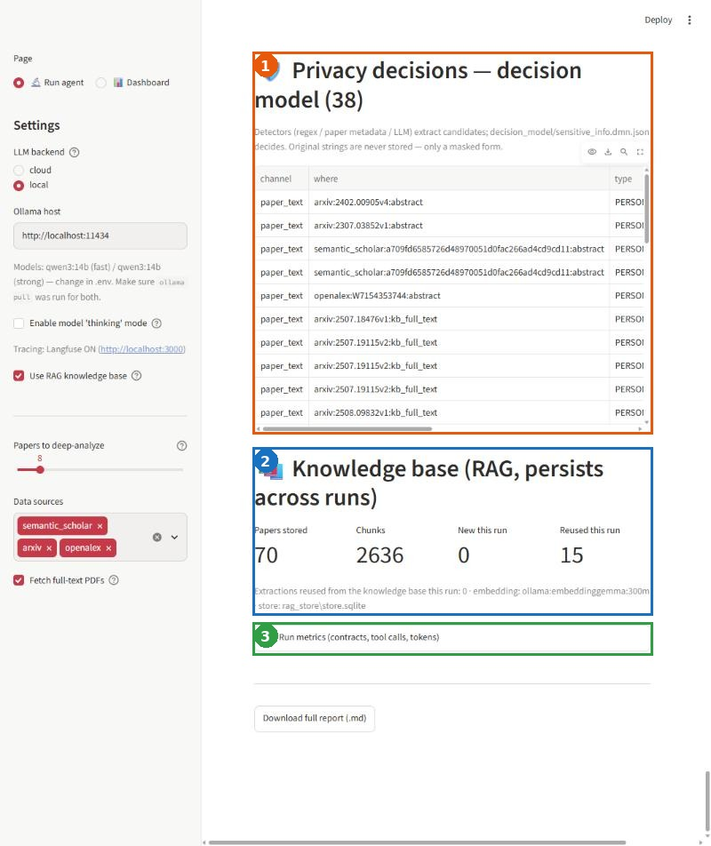

1.  Privacy decisions: ผลจาก decision model ต่อ entity (channel, where, type, role, detector, rule)

2.  Knowledge base: paper ที่เก็บ, chunks, ใหม่/นำกลับมาใช้

3.  Run metrics: contract pass rate, tool calls, token

รูป 4-7: Dashboard

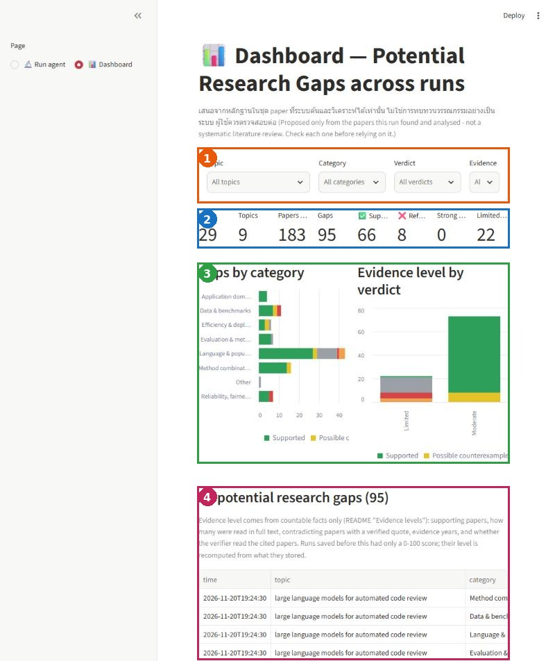

1.  ตัวกรอง topic / category / verdict / evidence

2.  KPI รวมทุก run

3.  กราฟ gap ตามหมวด (ontology ของ gap) และตามระดับหลักฐาน

4.  ตาราง gap ทุกข้อ

รูป 4-8: Langfuse trace

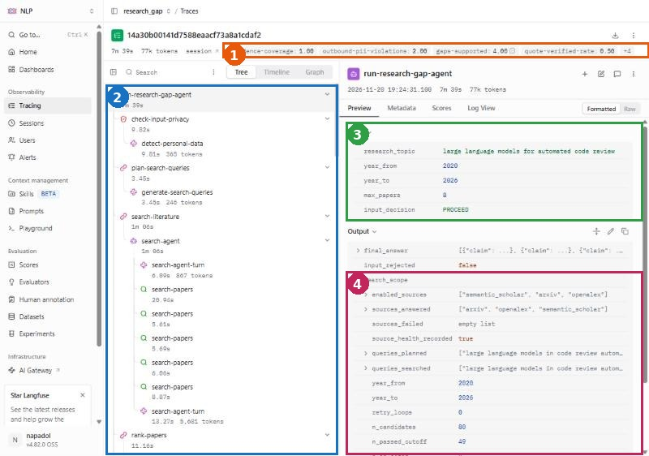

1.  Scores ที่ส่งจากโค้ด

2.  Trace tree: observation ต่อ node, agent, generation และ tool

3.  Input ระดับ trace (หัวข้อที่ redact แล้ว)

4.  Output ระดับ trace: `search_scope`

## 5. Ontology

โปรเจกต์นี้ไม่มี ontology แบบ formal (ไม่มีไฟล์ OWL/RDF หรือ knowledge graph ค้นคำว่า "ontolog" ในโค้ดและ README ไม่พบ) สิ่งที่ทำหน้าที่คล้าย ontology คือชุดคำศัพท์ควบคุม (controlled vocabulary) และ schema ที่กำหนดชนิดของสิ่งต่าง ๆ และความสัมพันธ์ระหว่างกัน ดังนี้

| ชุดคำศัพท์ / schema  | ค่าที่กำหนด                                                                                                                                                                                         | อยู่ที่                                                                          | ใช้ที่ไหน                                              |
|-------------------|--------------------------------------------------------------------------------------------------------------------------------------------------------------------------------------------------|------------------------------------------------------------------------------|-----------------------------------------------------|
| หมวดของ gap       | Language & population, Data & benchmarks, Method combination, Evaluation & metrics, Application domain & setting, Efficiency & deployment, Reliability fairness & explainability, Other (8 หมวด) | `GAP_CATEGORIES` contracts.py:88; `normalize_category` แมปคำที่ LLM ตอบเข้าหมวด | Dashboard กราฟ Gaps by category                     |
| ชนิด entity        | PERSON, EMAIL, PHONE, ID_NUMBER, ADDRESS, ORGANIZATION, OTHER                                                                                                                                    | sensitive_info.dmn.json (inputs ของ entity_action)                           | privacy + decision model                            |
| บทบาทของ entity   | author, cited_author, subject_person, eponym, affiliation, contact, other                                                                                                                        | sensitive_info.dmn.json                                                      | ตัดสิน REDACT/KEEP (เช่น eponym เก็บไว้)                 |
| ช่องทางของข้อความ   | user_input, paper_text, final_answer                                                                                                                                                             | sensitive_info.dmn.json                                                      | เกณฑ์ต่างกันตามช่องทาง (R5 vs R6)                       |
| Section ของ paper | references, acknowledgements, abstract, limitations, conclusion, related_work, results, experiments, method, introduction, appendix                                                              | `_SECTION_RULES` rag_store.py:38-49                                          | ตัด chunk ตาม section และให้ verifier ค้นเฉพาะ section |
| ระดับหลักฐาน        | Strong / Moderate / Limited (หลักฐานมาก/ปานกลาง/จำกัด)                                                                                                                                             | `LEVELS`, `LEVEL_TH` evidence.py:95-96                                       | รายงาน, UI, Dashboard                               |
| ชนิดข้อมูลใน state   | `Paper`, `PaperExtract`, `GapCandidate`, `AgentState`                                                                                                                                            | state.py:11, 26, 42, 62                                                      | สิ่งที่ node ส่งต่อกัน                                     |
| ชนิด observation   | agent, chain, generation, retriever, embedding, guardrail                                                                                                                                        | tracing.py:43-58                                                             | Langfuse                                            |

ความสัมพันธ์หลักที่โค้ดใช้จริง: Gap → อ้าง Paper ≥ 2 เรื่อง (`supporting_paper_ids`), Paper → มี PaperExtract 1 ชุด, Paper → แบ่งเป็น chunk ตาม section, Gap → อาจมี Paper ที่ขัดแย้ง (counterexample) ถ้าอยากได้ ontology จริง กลุ่มต้องเขียนความสัมพันธ์เหล่านี้เป็นไฟล์แยก (เช่น OWL หรือ JSON-LD) ซึ่งตอนนี้ยังไม่มี

รูป 5-1: หมวดของ gap (contracts.py:86-97)

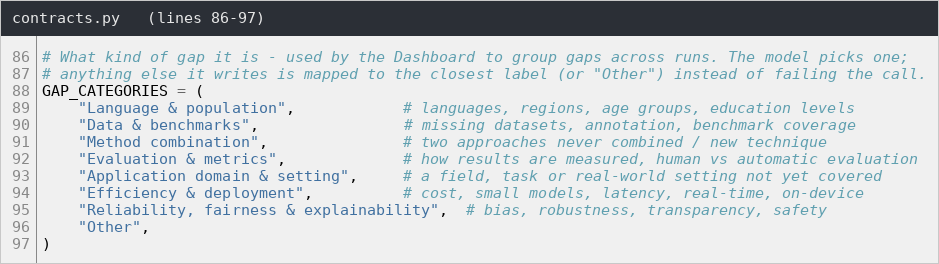

รูป 5-2: กฎจัด section ของ paper (rag_store.py:38-52)

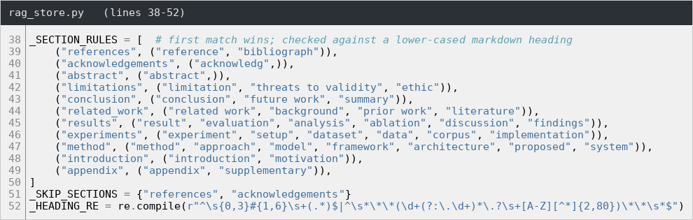

## 6. OPA / Policy

โปรเจกต์ไม่ได้ใช้ OPA (Open Policy Agent) ไม่มีไฟล์ Rego หรือ policy server (ค้นคำว่า opa / rego ไม่พบ) policy ทั้งหมดเขียนเป็นโค้ด Python ใน harness และเป็นตารางตัดสินใจใน decision model หลักการคือ LLM เสนอ แต่ harness เป็นฝ่ายบังคับ

| Policy                                                | บังคับที่                                                        | เมื่อฝ่าฝืน                                                     |
|-------------------------------------------------------|--------------------------------------------------------------|-------------------------------------------------------------|
| ใช้ได้เฉพาะแหล่งที่เปิดใน sidebar                           | tools.py:170-175                                             | คืน error "source ... is disabled for this run" ให้ LLM       |
| ปีต้องอยู่ในช่วงที่ผู้ใช้เลือก                                   | tools.py:176-182                                             | clamp แล้วบอกใน `policy_notes`                               |
| งบ `search_papers` ต่อรอบ (`MAX_SEARCH_TOOL_CALLS`=10) | tools.py:165-166                                             | คืน "search budget ... is used up"                           |
| ลบ placeholder ของข้อมูลส่วนบุคคลออกจากคำค้น               | tools.py:184-188                                             | ตัดออกและบอกใน `policy_notes`                                |
| Verifier อ่านได้เฉพาะ paper ที่วิเคราะห์แล้ว                 | `VerifierToolContext._unknown` (tools.py)                    | คืน "not among the analyzed papers (it may be a made-up id)" |
| ปริมาณข้อความที่คืนให้ verifier เป็นการตัดสินของ harness       | `VERIFIER_TEXT_CHARS`=3000 (config.py), contracts.py:177-180 | LLM ส่ง max_chars ไม่ได้                                       |
| จำกัดรอบและ token                                      | `MAX_TOOL_STEPS`, `MAX_RETRY_LOOPS`, `MAX_RUN_TOKENS`        | บังคับตอบ / หยุด retry                                         |
| Privacy policy                                        | decision model `entity_action`, `input_action` (หัวข้อ 10)     | REDACT หรือ REJECT                                           |
| Outbound policy: ไม่ให้ PII หรือ API key ออกจากโปรเซส    | `outbound.enforce` (outbound.py:53)                          | redact และนับ `outbound_pii_violations`                      |

ทุกครั้งที่ policy เปลี่ยน argument จะมี `policy_notes` แนบไปใน context ที่ LLM เห็น และอยู่ใน `tool_trace` ด้วย (ใน run 19:24 ไม่มี note เพราะ argument ทุกตัวอยู่ในกรอบอยู่แล้ว) ถ้าจะย้ายไปใช้ OPA จุดที่เหมาะคือกฎใน `SearchToolContext.execute` เพราะเป็น allow/deny ต่อ tool call อยู่แล้ว

รูป 6-1: policy ใน executor ของ `search_papers` (tools.py:159-182)

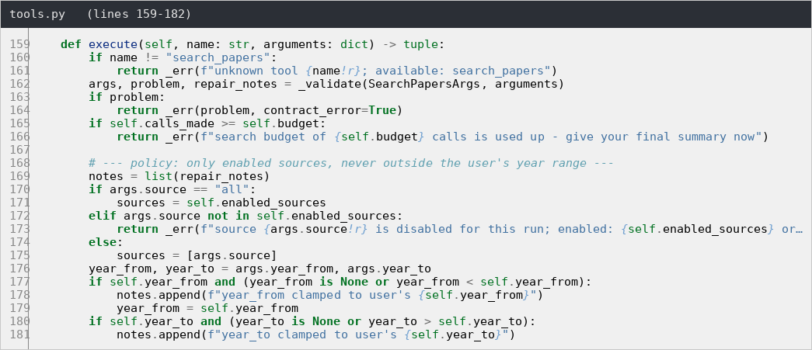

## 7. Harness tuning

Harness tuning คือการปรับโค้ดรอบ LLM จากผลที่วัดได้จริง ไม่ใช่การเดา คำนี้ปรากฏในโค้ดที่ config.py:79 และ evaluation/consistency_test.py:2

| สิ่งที่ปรับ                                 | ค่าปัจจุบัน                                                                          | อยู่ที่                                                       | หลักฐานที่ใช้ตัดสิน                                                                      |
|----------------------------------------|----------------------------------------------------------------------------------|-----------------------------------------------------------|------------------------------------------------------------------------------------|
| Sampling คงที่                           | `LLM_TEMPERATURE=0`, `LLM_SEED=42`                                               | config.py:79-85                                           | consistency test 5 ครั้ง: gap similarity 1.0 → PASS (consistency_20261118_171247.md) |
| Profile ต่อโมเดล                        | gpt-oss: think="low", ไม่บังคับ format=json                                         | `OLLAMA_PROFILES` llm_client.py:334                       | gpt-oss ปิด thinking ไม่ได้และคืนค่าว่างเมื่อใช้ format=json                                |
| Thinking เฉพาะบางขั้น                    | `OLLAMA_THINK=false`, `OLLAMA_THINK_PURPOSES` ว่าง (default)                      | config.py:65-69                                           | README: thinking ทุกขั้นช้า 12.5 นาที vs ปิด 7.0 นาที และทำให้ verifier ไม่เรียก tool        |
| Context window ของ Ollama              | คำนวณจาก prompt, เพดาน `OLLAMA_MAX_CTX`=8192, เผื่อคำตอบ 2048 (+6144 เมื่อ thinking) | `_reply_reserve`, `_ollama_num_ctx` llm_client.py:350-357 | thinking ยาวดัน prompt หลุด window                                                   |
| ซ่อม argument ก่อน validate              | clamp เลข, แปลงสตริง, ตัด argument ที่ tool ไม่รับ                                     | `repair_arguments` tools.py:97                            | ลด turn ที่เสียไปกับ error ที่เจตนาชัด                                                    |
| เอา max_chars ออกจาก `get_paper_text`  | harness เป็นฝ่ายกำหนด 3000 ตัวอักษร                                                  | contracts.py:177-180                                      | qwen3:14b ขอ max_chars=10000 เกินขอบเขต 18 จาก 183 call                             |
| ปฏิเสธ extraction ที่ลอกคำอธิบายจาก prompt | validator ใน contract                                                            | contracts.py:60-70                                        | live run: extraction 4 จาก 8 คืนคำอธิบาย field แทนคำตอบ                              |
| งบ tool และรอบ                         | `MAX_TOOL_STEPS`=8, `MAX_SEARCH_TOOL_CALLS`=10, `MAX_RETRY_LOOPS`=3              | config.py, .env.example                                   | กัน loop ไม่รู้จบ                                                                      |
| Cut-off ของ ranking ต่อโมเดล            | embeddinggemma 0.50                                                              | `RANKING_THRESHOLDS` embeddings.py                        | calibrate กับ 138 candidate ที่ label ด้วยมือ                                           |
| เลือกโมเดล                              | qwen3:14b                                                                        | .env                                                      | compare_models: เร็วสุด 377 s/run, ไม่มี run ล้ม                                        |

รูป 7-1: sampling คงที่ (config.py:79-88)

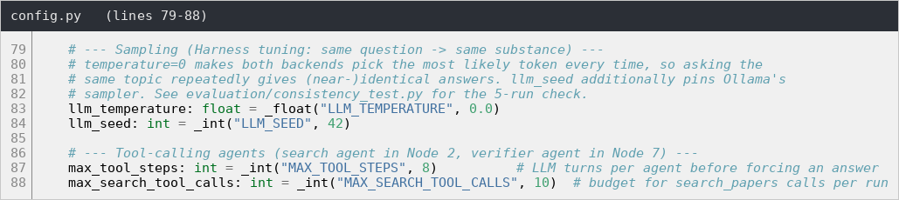

รูป 7-2: profile ต่อโมเดล (llm_client.py:330-343)

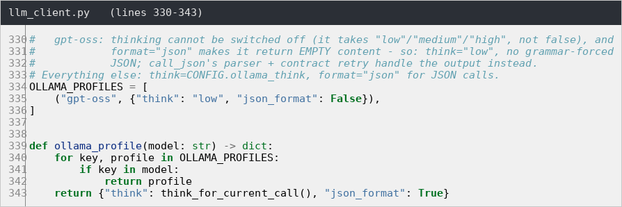

รูป 7-3: repair-before-validate (tools.py:97-132)

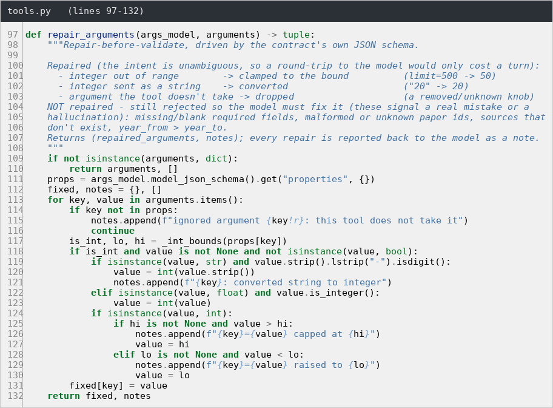

## 8. Contract

Contract คือ pydantic model ที่กำหนดรูปร่างของทุกสิ่งที่ LLM ส่งออกมา ทั้งคำตอบ JSON และ argument ของ tool บวกกับ outbound contract ที่คุมสิ่งที่ออกจากโปรเซส ทั้งหมดอยู่ใน contracts.py และ outbound.py

| Contract                                                        | บรรทัด                      | กฎสำคัญ                                                                | ใช้กับ                               |
|-----------------------------------------------------------------|----------------------------|-----------------------------------------------------------------------|------------------------------------|
| `KeywordOutput`                                                 | contracts.py:31            | queries 1–8 รายการ                                                    | node 1                             |
| `PaperExtractOutput`                                            | contracts.py:44            | method และ key_findings ห้ามว่าง, ห้ามลอกคำอธิบาย field จาก prompt        | node 5                             |
| `GapItem` / `GapProposalOutput`                                 | contracts.py:112, 124      | claim ≥ 10 ตัวอักษร, ต้องมี supporting_paper_ids, ไม่เกิน 6 gap             | node 7 (proposer)                  |
| `VerifierOutput`                                                | contracts.py:128           | facts ที่ `verifier_decision` ใช้ตัดสิน                                    | node 7 (verifier)                  |
| `SensitiveEntity` / `SensitiveEntitiesOutput`                   | contracts.py:148, 155      | confidence 0–1                                                        | privacy                            |
| `SearchPapersArgs`                                              | contracts.py:162           | query 2–200 ตัว, source เป็นหนึ่งใน 4 ค่า, limit 1–50, year_from ≤ year_to | tool `search_papers`               |
| `GetPaperTextArgs`, `SearchPaperChunksArgs`, `SearchCorpusArgs` | contracts.py:176, 184, 190 | paper_id ต้องขึ้นต้นด้วย semantic_scholar:/arxiv:/openalex:, k มีขอบเขต     | tool ของ verifier                  |
| Outbound contract                                               | outbound.py:53             | ไม่มี PII หรือ API key ใน trace, state JSON, report                      | Langfuse mask hook, `save_outputs` |

เมื่อ contract ไม่ผ่าน: คำตอบ JSON → `call_json` ถามซ้ำพร้อม error สูงสุด 3 ครั้ง แล้ว raise `LLMError`; argument ของ tool → คืน error ให้ LLM แก้ใน turn ถัดไป; outbound → redact แล้วตรวจซ้ำ ถ้ายังเหลือจะ force-redact

ผลจริงจาก run 19:24 (`run_metrics`): JSON call 12 ครั้ง, contract violation 6 ครั้ง, ต้องถามซ้ำ 2 ครั้ง, ล้มหลังครบ 3 ครั้ง 2 ครั้ง (`contract_first_try_rate` = 0.833) สองครั้งที่ล้มคือ paper 2 เรื่องที่ถูกข้ามด้วย "extraction failed (LLMError)" ส่วน argument ของ tool ผ่านทุกตัว (`tool_args_valid_rate` = 1.0)

รูป 8-1: contract ของ argument tool (contracts.py:160-193)

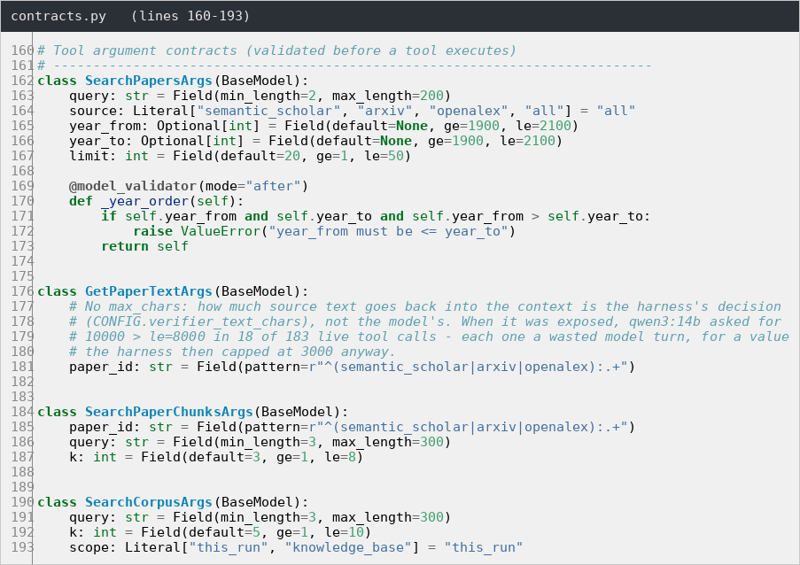

รูป 8-2: contract ของ extraction (contracts.py:44-72)

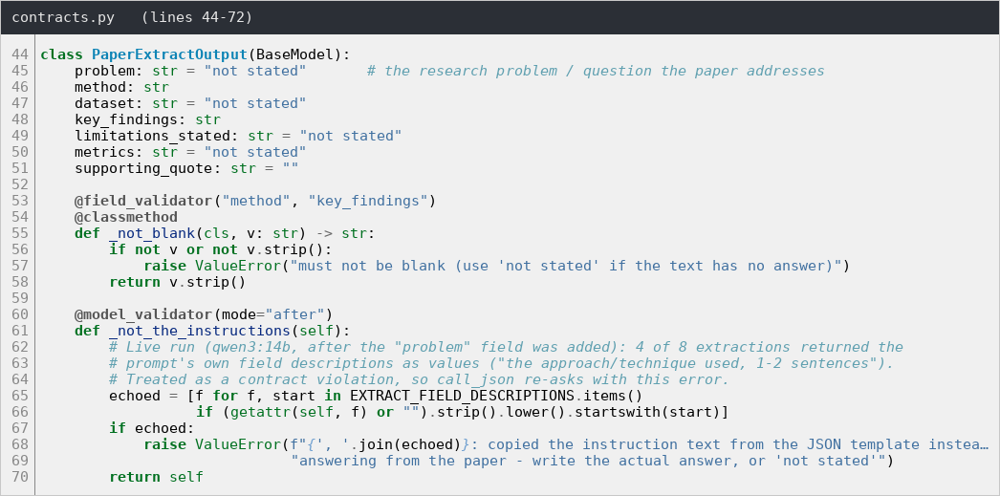

รูป 8-3: ถามซ้ำเมื่อผิด contract (llm_client.py:157-200)

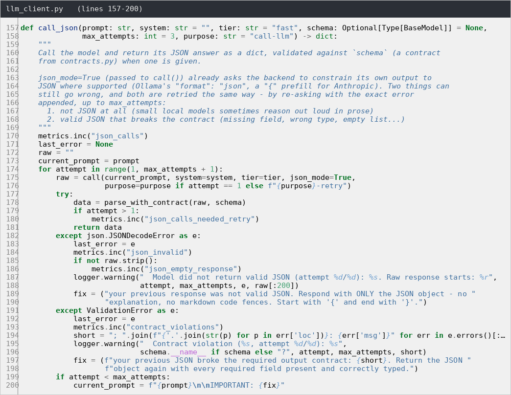

รูป 8-4: outbound contract (outbound.py:53-69)

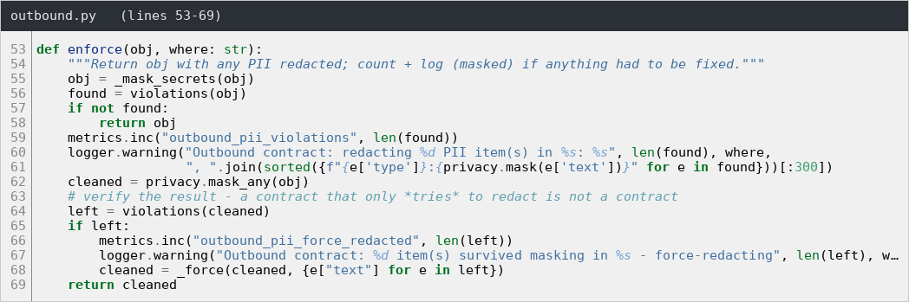

## 9. KM (RAG knowledge base)

KM ของโปรเจกต์คือ knowledge base ที่เก็บข้าม run ใน SQLite `rag_store/store.sqlite` (rag_store.py) เก็บเฉพาะ paper ที่ถูกเลือกวิเคราะห์เชิงลึก และเก็บเฉพาะข้อความที่ redact แล้ว

| ส่วน                  | อยู่ที่                                                                                                               | ทำอะไร                                                                                                     |
|----------------------|-------------------------------------------------------------------------------------------------------------------|------------------------------------------------------------------------------------------------------------|
| Schema 3 ตาราง       | rag_store.py:106-113                                                                                              | `papers` (หนึ่งแถวต่อ paper), `chunks` (ข้อความ + section + vector), `extracts` (cache ผล extraction)          |
| ตัด chunk ตาม section | `chunk_text` rag_store.py:63                                                                                      | อ่านหัวข้อ Markdown, หยุดที่ references, chunk 1200 ตัวอักษร overlap 200 (.env.example)                            |
| Index                | `index_paper` rag_store.py:124                                                                                    | paper ที่เคย index แล้วไม่ทำซ้ำ (นับ `rag_papers_reused`) แต่ full text แทน abstract ได้                           |
| ค้น                   | `search` / `_search` rag_store.py:164, 174                                                                        | cosine แบบ exact ด้วย numpy กรองตาม paper และ section ได้ ทุกครั้งส่ง observation `retrieve-chunks` เข้า Langfuse |
| Cache extraction     | `get_extract` / `put_extract` rag_store.py:200, 204                                                               | ข้อความ + prompt + model เดิม → ใช้ผลเดิมไม่เรียก LLM                                                            |
| ผู้ใช้ KM               | node 5 (ดึง chunk method/dataset/results/limitations), tool `search_paper_chunks` และ `search_corpus` ของ verifier | ให้ extraction อ่านส่วนท้าย paper ได้ และให้ verifier หา counterexample                                          |
| Embedding            | `RAG_EMBEDDING` (ในเครื่อง: `ollama:embeddinggemma:300m`)                                                           | เลือกจาก compare_embeddings: hit@3 EN 0.88 / TH 0.76                                                        |

สถานะจริงหลัง run 19:24 (`knowledge_base` ใน state JSON): 70 papers (full text 53), 2,636 chunks, extraction ที่ cache 74 รายการ run นี้ค้น KM 39 ครั้ง (`rag_searches`) และนำ paper ที่ index แล้วกลับมาใช้ 8 เรื่อง

รูป 9-1: schema ของ KM ใน SQLite (rag_store.py:99-115)

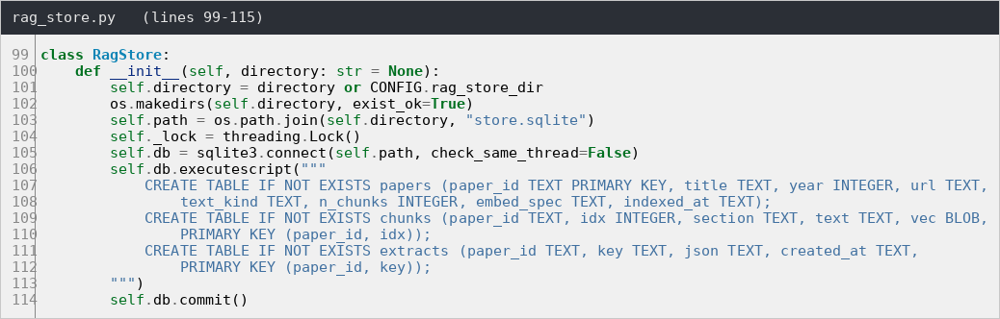

รูป 9-2: ค้น chunk ด้วย cosine (rag_store.py:174-197)

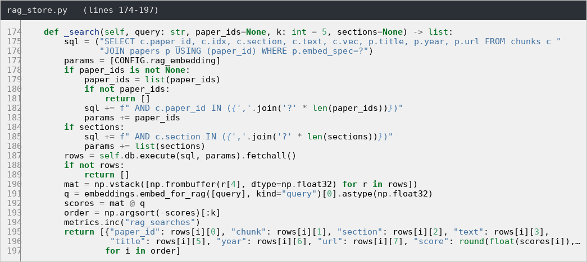

## 10. Decision model

หลักที่ใช้ทั้งโปรเจกต์คือ "LLM สกัด โค้ดตัดสิน" decision model หลักคือตารางแบบ DMN ใน `decision_model/sensitive_info.dmn.json` ประเมินด้วย `decision_model/__init__.py` (hit policy FIRST: กฎแรกที่ตรงชนะ) การเปลี่ยนพฤติกรรมทำโดยแก้แถวในตาราง ไม่ใช่แก้ prompt ทุกการตัดสินบันทึกว่ากฎไหนทำงาน

| ตาราง           | Input                                                     | Output                                                | กฎ                                                                     |
|-----------------|-----------------------------------------------------------|-------------------------------------------------------|------------------------------------------------------------------------|
| `entity_action` | type, role, detected_by, confidence, channel              | action (REDACT/KEEP), label                           | R1–R8 เช่น R2 eponym → KEEP, R5 ชื่อในหัวข้อที่ผู้ใช้พิมพ์ ความมั่นใจ ≥ 0.4 → REDACT |
| `input_action`  | n_person_redacted, n_contact_redacted, content_words_left | action (PROCEED / PROCEED_REDACTED / REJECT), message | I1–I4 เช่น I1 เหลือคำเนื้อหา \< 2 → REJECT                                 |

จุดเรียก: `privacy.decide_and_redact` (privacy.py:179) ส่งทุก entity ที่ regex / metadata / LLM สกัดได้เข้า `entity_action` ใน run 19:24 หน้า UI แสดง Privacy decisions 38 รายการ (รูป 4-6)

นอกจากตาราง DMN ยังมี decision rule แบบเดียวกันที่เขียนเป็นโค้ด Python:

| Decision                | อยู่ที่                                    | LLM ส่งอะไรมา                                       | โค้ดตัดสินอะไร                                                      |
|-------------------------|----------------------------------------|----------------------------------------------------|------------------------------------------------------------------|
| Gap supported / refuted | `verifier_decision` nodes.py:473       | facts: relevant, counterexample, quote, overstated | counterexample นับเมื่อ quote ≥ 30 ตัวอักษรและมีอยู่จริงในข้อความที่ tool คืน |
| ระดับหลักฐาน              | `evidence_level` evidence.py:119       | ไม่มี (ใช้ค่าที่นับได้เท่านั้น)                               | Strong / Moderate / Limited ตามเกณฑ์ใน config.py:176-193          |
| Retry / extract         | `route_after_sufficiency` nodes.py:218 | ไม่มี                                                | จำนวน paper, `MAX_RETRY_LOOPS`, `MAX_RUN_TOKENS`                 |
| Proceed / reject หัวข้อ   | `route_after_input` nodes.py:77        | entity ที่สกัดได้                                      | ตามผล `input_action`                                             |

รูป 10-1: ตารางกฎ (sensitive_info.dmn.json:18-46)

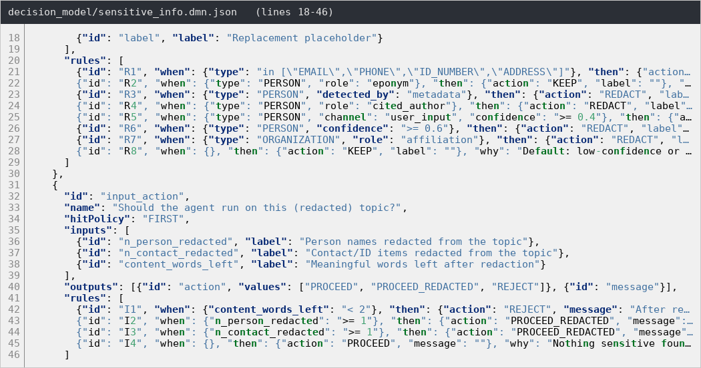

รูป 10-2: ตัวประเมินตาราง (`decision_model/__init__.py:50-58`)

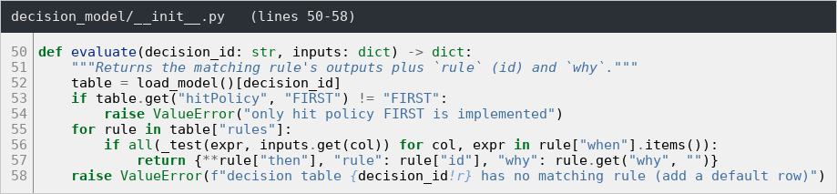

รูป 10-3: privacy เรียก decision model (privacy.py:179-204)

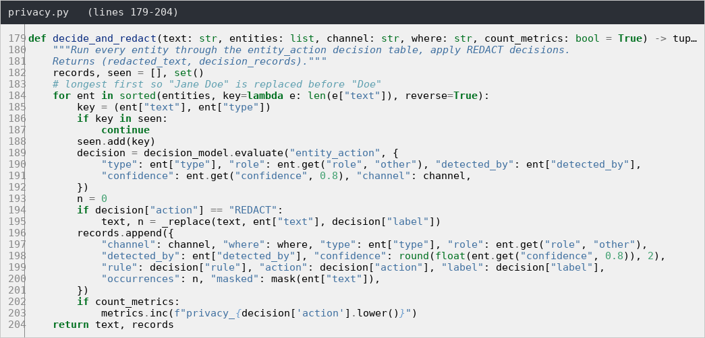

รูป 10-4: decision rule ของระดับหลักฐาน (evidence.py:119-149)

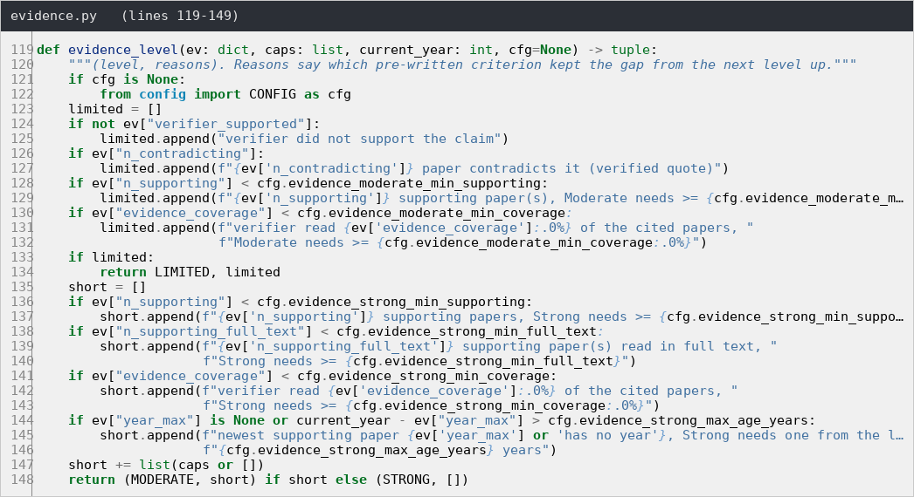

รูป 10-5: decision rule ของ retry (nodes.py:218-236)

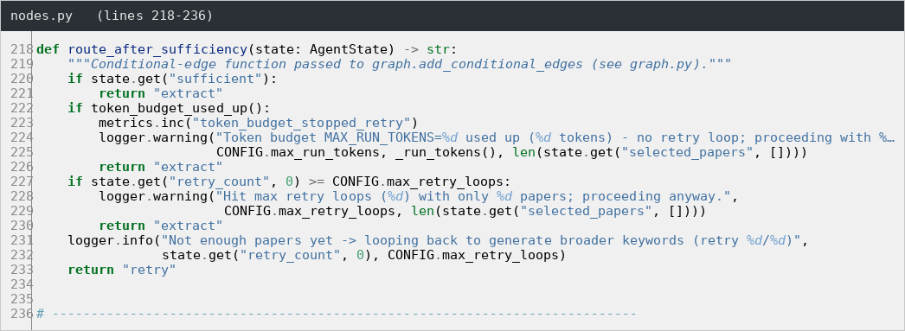

## 11. Langfuse

ทุก run เป็น 1 trace บน Langfuse self-hosted (`http://localhost:3000`) เปิดอัตโนมัติเมื่อมี `LANGFUSE_PUBLIC_KEY` และ `LANGFUSE_SECRET_KEY` ถ้าไม่มี tracing.py เป็น no-op ทั้งหมด

| สิ่งที่ส่งเข้า Langfuse   | Observation (type)                                                                    | สร้างที่                                       |
|---------------------|---------------------------------------------------------------------------------------|---------------------------------------------|
| ทั้ง run              | `run-research-gap-agent` (agent) พร้อม tags, version, session                          | `run_trace` tracing.py:205                  |
| แต่ละ graph node     | ชื่อตาม `NODE_OBSERVATIONS` (chain / guardrail)                                         | `wrap_node` tracing.py:287                  |
| LLM call ทั่วไป       | ชื่อตาม purpose เช่น `generate-search-queries`, `propose-gaps` (generation)              | llm_client.py:105                           |
| Tool-calling agent  | `search-agent`, `verifier-agent` (agent)                                              | llm_client.py:405                           |
| แต่ละ turn ของ agent | `<agent>-turn` (generation) มี tool calls ใน output                                    | llm_client.py:465                           |
| แต่ละ tool call      | `search-papers`, `search-paper-chunks`, `search-corpus`, `get-paper-text` (retriever) | llm_client.py:429                           |
| Embedding / RAG     | `embed-texts` (embedding), `retrieve-chunks` (retriever)                              | embeddings.py:33, 82, 142; rag_store.py:166 |
| คะแนนต่อ trace       | gaps-supported, quote-verified-rate, evidence-coverage, outbound-pii-violations       | tracing.py:272-281                          |
| Output ระดับ trace   | final_answer (มี evidence_level), search_scope                                         | tracing.py:255-268                          |

ความปลอดภัย: Langfuse ได้ `mask` hook ที่เรียก `outbound.enforce` กับทุก payload (tracing.py:66-92) และ node 0 บันทึก input เป็น `[withheld: raw user input before redaction]` (tracing.py:307)

ค่าจริงของ trace `14a30b00141d7588eaacf73a8a1cdaf2` (run 19:24): ใช้เวลา 7m 39s, 77k tokens, evidence-coverage 1.00, outbound-pii-violations 2.00, gaps-supported 4.00, quote-verified-rate 0.50 (รูป 4-8)

รูป 11-1: ชื่อและชนิด observation (tracing.py:43-58)

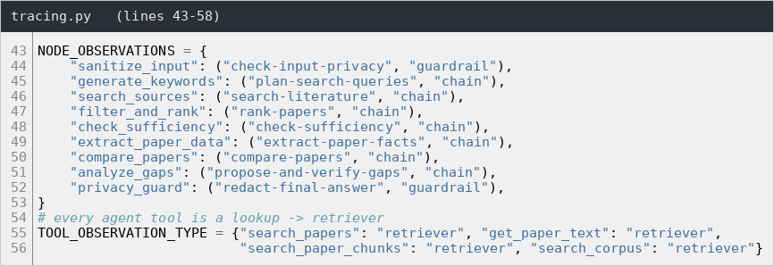

รูป 11-2: สร้าง client พร้อม mask hook (tracing.py:66-92)

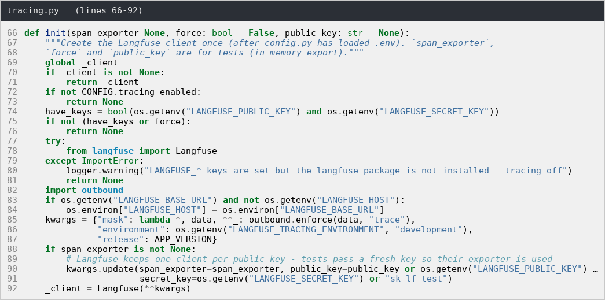

รูป 11-3: ห่อ graph node เป็น observation (tracing.py:287-320)

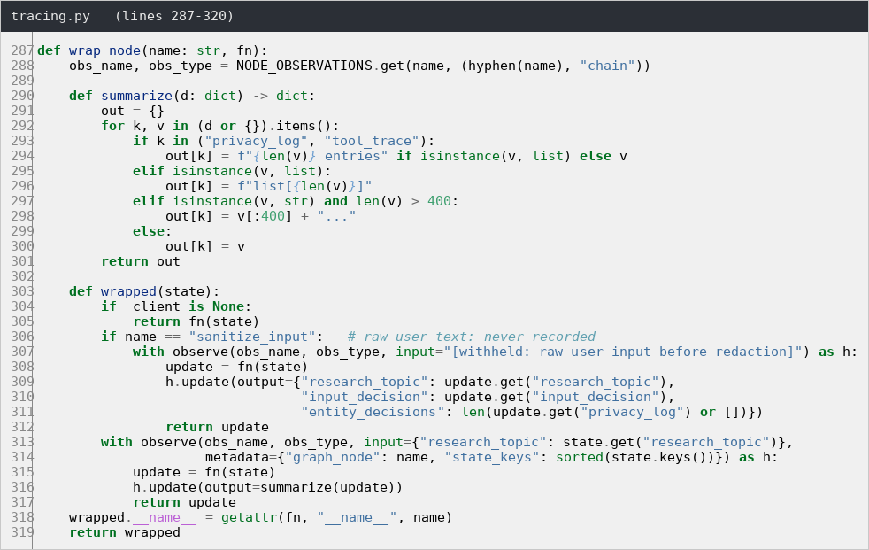
