# AI Research Gap Agent — เอกสารอธิบายโปรเจกต์

2026-11-20 (ตรวจทานและอัปเดต 2026-11-21)

ทุกข้อมูลในเอกสารนี้อ้างอิงจากโค้ดในโฟลเดอร์ D:\NLP_mini_project\ai_research_gap_agent (branch `main` โค้ดล่าสุดคือ commit `801553a` ไม่มีการแก้โค้ดหลังจากนั้น) และจากการรันแอปจริง ฉบับนี้อัปเดตหลังปรับระบบตาม feedback ของอาจารย์ (ดูหัวข้อ 9) การตรวจทานวันที่ 2026-11-21 เทียบเลขบรรทัดและตัวเลขทุกจุดกับโค้ดและไฟล์ใน `output/` อีกครั้ง แก้จุดที่ผิด และเพิ่มผลจาก run วันที่ 21 พ.ย. (หัวข้อ 7.2 และ 8.3)

## 1. ภาพรวมโปรเจกต์

ระบบนี้คือ AI agent ที่รับหัวข้อวิจัย 1 หัวข้อ แล้วเสนอ "Potential Research Gaps" 2–4 ข้อจากหลักฐานในชุด paper ที่ระบบค้นและวิเคราะห์ได้ เพื่อให้ผู้ใช้ตรวจสอบต่อ ไม่ใช่การทบทวนวรรณกรรมอย่างเป็นระบบ (`evidence.LIMITATION_NOTE`, evidence.py:14-18) แต่ละ gap มีระดับหลักฐาน มาก/ปานกลาง/จำกัด ที่คำนวณจากค่าที่นับได้ ขั้นตอนคือ ค้นแหล่งวิชาการ → คัด paper ที่เกี่ยวข้อง → สกัด Problem/Method/Dataset/Findings (อ่าน PDF ฉบับเต็มได้) → เปรียบเทียบ → เสนอ gap → ตรวจ gap กับต้นฉบับ

| หัวข้อ            | รายละเอียด                                                                                   | แหล่งอ้างอิง                                                              |
|-----------------|---------------------------------------------------------------------------------------------|------------------------------------------------------------------------|
| Input           | หัวข้อวิจัย, ช่วงปี (year_from/year_to), จำนวนเปเปอร์ที่วิเคราะห์เชิงลึก                                 | main.py:106 `run()`, แฟล็ก `--topic --year-from --year-to --max-papers` |
| Output          | รายงาน Markdown `output/<timestamp>_report.md` + state JSON `output/<timestamp>_state.json` | main.py:136 `save_outputs()`                                           |
| แหล่งเปเปอร์      | Semantic Scholar, arXiv, OpenAlex (+ PDF open-access)                                       | sources/semantic_scholar.py, arxiv.py, openalex.py, pdf_extract.py     |
| Orchestration   | LangGraph `StateGraph` 9 nodes                                                              | graph.py                                                               |
| LLM             | 2 backend: cloud (Anthropic) / local (Ollama) แบ่งเป็น tier fast/strong                       | llm_client.py, .env.example                                            |
| ค่าที่ใช้จริงในเครื่อง | `LLM_BACKEND=local`, qwen3:14b ทั้ง fast และ strong, Langfuse ที่ `http://localhost:3000`       | .env (บรรทัด 2, 11-12, 75), output/20261119_210348_state.json `run_info`       |
| UI              | Streamlit 2 หน้า: Run agent และ Dashboard                                                    | app.py:276, dashboard_page.py                                          |
| Observability   | Langfuse (optional, ปิดอัตโนมัติถ้าไม่มี key)                                                      | tracing.py, outbound.py                                                |

ไลบรารีหลักจาก requirements.txt: langgraph\>=0.2.0, langchain-core, anthropic\>=0.40.0, httpx, sentence-transformers\>=3.0.0, numpy, pydantic\>=2.8.0, mcp\>=1.0.0, tenacity, streamlit\>=1.50.0, pymupdf4llm==0.0.17, pytest, langfuse\>=3.0.0

โครงสร้างไฟล์หลัก (จำนวนบรรทัดจาก `wc -l`):

| ไฟล์                              | บรรทัด     | หน้าที่                                            |
|----------------------------------|-----------|-------------------------------------------------|
| nodes.py                         | 749       | 9 graph nodes                                   |
| app.py                           | 692       | Streamlit web UI                                |
| llm_client.py                    | 570       | LLM wrapper + tool-calling loop                 |
| privacy.py                       | 423       | detector + redaction                            |
| tracing.py                       | 367       | Langfuse tracing                                |
| tools.py                         | 308       | tool spec + executor                            |
| dashboard.py / dashboard_page.py | 255 / 179 | หน้า Dashboard                                   |
| rag_store.py                     | 227       | RAG knowledge base (SQLite + numpy)             |
| evidence.py                      | 207       | Search scope, ระดับหลักฐาน, ประโยคหลักฐาน (ไฟล์ใหม่) |
| config.py                        | 199       | ค่า config ทั้งหมด รวมเกณฑ์ระดับหลักฐาน               |
| contracts.py                     | 193       | pydantic contracts                              |
| prompts.py                       | 190       | prompt ทุกตัว                                     |
| embeddings.py                    | 188       | embedding + ranking                             |
| main.py                          | 175       | CLI entrypoint + รายงาน Markdown                |
| state.py                         | 117       | `AgentState` schema                             |
| logging_utils.py                 | 105       | logging + ตัวซ่อน API key                         |
| outbound.py                      | 81        | outbound PII contract                           |
| graph.py                         | 57        | ต่อ node เป็น graph                               |

## 2. สถาปัตยกรรม (LangGraph)

ทั้งระบบเป็น LangGraph `StateGraph` เดียว มี 9 nodes และ conditional edge 2 จุด ทุก node ถูกห่อด้วย `tracing.wrap_node()` ก่อนใส่เข้า graph เพื่อส่ง trace ไป Langfuse


กล่องที่เน้นสีคือ node ที่ให้ LLM เลือกเรียก tool เอง (search agent ใน node 2, verifier agent ใน node 7) ส่วน node 4 ไม่เรียก LLM เลย

``` python
# graph.py:22-57 (ตัดมาบางส่วน)
def build_graph():
    graph = StateGraph(AgentState)
    graph.add_node("sanitize_input", tracing.wrap_node("sanitize_input", nodes.sanitize_input))
    ...
    graph.set_entry_point("sanitize_input")
    graph.add_conditional_edges("sanitize_input", nodes.route_after_input,
                                {"proceed": "generate_keywords", "reject": END})
    ...
    graph.add_conditional_edges(
        "check_sufficiency",
        nodes.route_after_sufficiency,
        {"retry": "generate_keywords", "extract": "extract_paper_data"},
    )
    graph.add_edge("extract_paper_data", "compare_papers")
    graph.add_edge("compare_papers", "analyze_gaps")
    graph.add_edge("analyze_gaps", "privacy_guard")
    graph.add_edge("privacy_guard", END)
    return graph.compile()
```

State ที่ไหลผ่าน graph คือ `AgentState` (TypedDict, state.py:62) ประกอบด้วย `Paper` (state.py:11), `PaperExtract` (state.py:26) และ `GapCandidate` (state.py:42) แต่ละ node รับ state ทั้งก้อนแต่คืนเฉพาะ key ที่เปลี่ยน (dict) ตามแบบมาตรฐานของ LangGraph

## 3. รายละเอียดแต่ละ node (nodes.py)

ทุก node อยู่ใน nodes.py ตารางนี้บอกบรรทัดที่ฟังก์ชันเริ่ม สิ่งที่ทำ และ key ที่เขียนกลับเข้า state

| \#  | ฟังก์ชัน (บรรทัด)              | สิ่งที่ทำ                                                                                                                                                                                                                                          | เขียนลง state                                                    |
|-----|----------------------------|------------------------------------------------------------------------------------------------------------------------------------------------------------------------------------------------------------------------------------------------|-----------------------------------------------------------------|
| 0   | `sanitize_input` (55)      | ตรวจหัวข้อที่พิมพ์ด้วย `privacy.sanitize_topic()` → decision model ตัดสิน PROCEED / PROCEED_REDACTED / REJECT; `route_after_input` (77) ส่งไป END ถ้า REJECT                                                                                              | `research_topic` (ฉบับ redact), `input_decision`, `privacy_log`  |
| 1   | `generate_keywords` (84)   | LLM tier fast + `KeywordOutput` contract สร้าง 3–5 query; ตอน retry ต่อ `RETRY_CONTEXT_TEMPLATE` เพื่อเลี่ยง query เดิม                                                                                                                               | `search_queries`, `prior_queries_tried`                         |
| 2   | `search_sources` (112)     | search agent: LLM เรียก tool `search_papers` ผ่าน `llm_client.run_tool_loop`; ผลทุกชิ้นผ่าน `privacy.scrub_paper`                                                                                                                                    | `candidate_papers`, `search_summary`, `tool_trace`              |
| 3   | `filter_and_rank` (173)    | จัดอันดับด้วย cosine similarity ตัดด้วย threshold ต่อโมเดล แล้วเลือก top `max_papers`                                                                                                                                                                   | `ranked_papers`, `selected_papers`                              |
| 4   | `check_sufficiency` (197)  | กฎเดียว ไม่ใช้ LLM: `need = min(MIN_PAPERS_BEFORE_RETRY, max_papers)`; `route_after_sufficiency` (218) ตัดสิน retry/extract โดยดู `MAX_RETRY_LOOPS` และงบ token `MAX_RUN_TOKENS` (`token_budget_used_up`, 213)                                       | `sufficient`, `retry_count`                                     |
| 5   | `extract_paper_data` (278) | ดึง PDF open-access → Markdown (ถ้ามี) แล้ว LLM tier fast สกัด problem/method/dataset/findings/limitations/metrics + `supporting_quote`; ตรวจ quote ด้วย `_quote_verified` (41); paper ที่ไม่มีข้อความหรือสกัดไม่สำเร็จจะถูกบันทึกลง `skipped_papers` (326, 356) | `paper_extracts`, `skipped_papers`                              |
| 6   | `compare_papers` (430)     | สร้างตารางเปรียบเทียบ (มีคอลัมน์ Problem) แล้ว LLM tier strong สังเคราะห์แนวโน้ม                                                                                                                                                                         | `comparison_table`, `trend_summary`                             |
| 7   | `analyze_gaps` (562)       | เสนอ gap, ตัด id ที่ไม่มีจริง, บังคับ ≥ 2 paper, ส่ง verifier agent (`_verify_with_tools`, 499) แล้วคำนวณระดับหลักฐานด้วย `evidence.evidence_level` (666)                                                                                                   | `gap_candidates` (มี `evidence`, `evidence_level`), `tool_trace` |
| 8   | `privacy_guard` (716)      | ตรวจคำตอบสุดท้ายด้วย detector + decision model แล้ว redact                                                                                                                                                                                         | ฟิลด์คำตอบที่ redact แล้ว                                            |

### การตรวจสอบข้อเท็จจริง (fact-checking)

มี 2 ชั้น ทั้งคู่เป็นโค้ดตัดสิน ไม่ใช่ LLM ตัดสินเอง:

1.  Extraction-quote grounding (node 5): LLM ต้องคืน `supporting_quote` ที่คัดลอกจากเนื้อหา แล้วเทียบแบบ substring หลังจัด whitespace ไม่มี LLM call เพิ่ม

2.  Verifier (node 7): LLM รายงาน facts (เกี่ยวข้องไหม, มี counterexample ไหม, overstated ไหม) แล้ว `verifier_decision()` (nodes.py:473) ตัดสิน counterexample จะนับก็ต่อเมื่อมีประโยคที่คัดมาตรงตัว ≥ 30 ตัวอักษร (`MIN_COUNTEREXAMPLE_QUOTE_CHARS`) จากเนื้อหาที่ tool คืนมาจริง

``` python
# nodes.py:41-49
def _quote_verified(quote: str, source_text: str) -> bool:
    quote = (quote or "").strip()
    if not quote:
        return False
    return _normalize_whitespace(quote) in _normalize_whitespace(source_text)
```

### ระดับหลักฐานของ gap (evidence.py:100-149, config.py:176-193)

ระดับหลักฐานมาจากค่าที่นับได้เท่านั้น (`evidence.gap_evidence`) ไม่มีตัวเลขที่ LLM ประเมินตัวเอง เกณฑ์เขียนไว้ล่วงหน้าใน `config.py` และปรับได้ผ่าน `.env`

| ระดับ                     | เกณฑ์ (ค่า default)                                                                                                                                                                                  |
|--------------------------|----------------------------------------------------------------------------------------------------------------------------------------------------------------------------------------------------|
| Limited (หลักฐานจำกัด)     | verifier ไม่รับรอง หรือมี paper ที่ขัดแย้ง ≥ 1 (counterexample ที่ยืนยัน quote แล้ว) หรือ paper สนับสนุน \< 2 หรือ verifier อ่าน paper ที่อ้าง \< 50%                                                                   |
| Strong (หลักฐานมาก)       | ไม่ Limited และ paper สนับสนุน ≥ 3, อ่าน full text ≥ 2, verifier อ่านครบ 100%, paper ใหม่สุดอายุไม่เกิน 3 ปี และไม่ติด cap (`_confidence_caps`: วิเคราะห์ \< 8 paper, แหล่งที่ตอบ \< 2 หรือ counterexample ที่ยังไม่ยืนยัน) |
| Moderate (หลักฐานปานกลาง) | กรณีอื่นทั้งหมด                                                                                                                                                                                         |

ใต้ gap ทุกข้อแสดงค่าที่นับได้ (จำนวน paper สนับสนุน และกี่เรื่องอ่าน full text, จำนวน paper ที่ขัดแย้ง, ช่วงปีของหลักฐาน, coverage ของ verifier) และเหตุผลว่าทำไมไม่ได้ระดับสูงกว่า (`evidence.evidence_line`, evidence.py:151) คะแนน 0–100 แบบเดิมยังคำนวณและเก็บใน state (nodes.py:632) แต่ไม่ได้แสดงเป็นหลักแล้ว ใต้ gap แต่ละข้อยังแสดงประโยคหลักฐานจาก paper ที่สนับสนุน เฉพาะที่ `quote_verified` ถ้าไม่มีจะเขียนว่า "ไม่มีประโยคที่ยืนยันได้" (`evidence.evidence_quotes`, evidence.py:185)

## 4. แหล่งข้อมูล, tool calling, LLM client และ contracts

### 4.1 แหล่งเปเปอร์ (sources/)

แหล่งทั้ง 3 ลงทะเบียนใน `REGISTRY` (`sources/__init__.py:27`) แต่ละตัวมี interface เดียวกัน: `search_papers` / `get_paper` / `get_full_text`

| แหล่ง             | Endpoint (จากโค้ด)                                                  | หมายเหตุ                                                                     |
|------------------|--------------------------------------------------------------------|-----------------------------------------------------------------------------|
| Semantic Scholar | `https://api.semanticscholar.org/graph/v1` (semantic_scholar.py:9) | ใช้ `SEMANTIC_SCHOLAR_API_KEY`                                               |
| arXiv            | `https://export.arxiv.org/api/query` (arxiv.py:17)                 | query แบบ AND คำสำคัญ ถ้าได้ผล \< 5 (`MIN_STRICT_RESULTS`) จะลอง query ที่ผ่อนกว่า |
| OpenAlex         | `https://api.openalex.org/works` (openalex.py:10)                  | ต้องมี `OPENALEX_API_KEY`; สร้าง abstract คืนจาก inverted index                 |
| PDF → Markdown   | `pdf_extract.fetch_and_convert` (pdf_extract.py:36)                | ใช้ pymupdf4llm 0.0.17, cache ที่ `pdf_cache/`                                 |

`sources/net.py` คุม HTTP ทุกแหล่ง: throttle ต่อแหล่ง, retry เมื่อเจอ 429/500/502/503/504 (`RETRY_STATUS`, net.py:24) และปิดแหล่งที่ล้มติดกัน (`SOURCE_DISABLE_AFTER_FAILURES`=3) สถานะต่อแหล่ง (`source_health`) ถูกแสดงใน UI และใช้ตัดสิน confidence cap

### 4.2 Tool calling (tools.py + llm_client.py)

`llm_client.run_tool_loop()` (llm_client.py:399) เป็น tool-use loop ที่ใช้ได้ทั้ง Anthropic (`tool_use`/`tool_result`) และ Ollama (`/api/chat` + `message.tool_calls`) JSON schema ของ tool สร้างจาก pydantic contract (`tools._spec`, tools.py:31)

| Agent                   | Tool                  | Arguments ที่ LLM เลือก                        | Contract                                   |
|-------------------------|-----------------------|---------------------------------------------|--------------------------------------------|
| search agent (node 2)   | `search_papers`       | query, source, year_from, year_to, limit    | `SearchPapersArgs` (contracts.py:162)      |
| verifier agent (node 7) | `get_paper_text`      | paper_id (ความยาวข้อความที่คืนให้ harness กำหนดเองที่ `VERIFIER_TEXT_CHARS`=3000, LLM เลือกไม่ได้) | `GetPaperTextArgs` (contracts.py:176)      |
| verifier agent (node 7) | `search_paper_chunks` | paper_id, query, k                          | `SearchPaperChunksArgs` (contracts.py:184) |
| verifier agent (node 7) | `search_corpus`       | query, k, scope (this_run / knowledge_base) | `SearchCorpusArgs` (contracts.py:190)      |

Harness เป็นฝ่ายบังคับ policy ไม่ใช่ LLM: argument ต้องผ่าน contract, ใช้ได้เฉพาะแหล่งที่เปิดใน sidebar, ปีถูก clamp ในช่วงที่ผู้ใช้เลือก, มีงบจำนวน call (`MAX_SEARCH_TOOL_CALLS`=10, `MAX_TOOL_STEPS`=8) เมื่อหมดงบ loop จะสั่งให้ตอบโดยไม่ใช้ tool อีก (llm_client.py:451-456)

### 4.3 LLM client

`llm_client.call()` (llm_client.py:85) เลือกโมเดลจาก backend + tier แล้วเรียก `_call_anthropic` (207) หรือ `_call_ollama` (235) ทุกครั้งห่อด้วย `tracing.observe(..., "generation")` `call_json()` (157) ถ้า JSON ไม่ผ่าน contract จะถามซ้ำพร้อม validation error ค่า sampling ตั้งใน .env.example: `LLM_TEMPERATURE=0`, `LLM_SEED=42`

| ค่า          | cloud (ค่าใน .env.example) | local (ค่าใน .env.example) |
|-------------|---------------------------|---------------------------|
| tier fast   | claude-haiku-4-5          | qwen3:8b                  |
| tier strong | claude-sonnet-4-5         | qwen3:14b                 |

ในเครื่องที่รันจริง sidebar แสดง `qwen3:14b (fast) / qwen3:14b (strong)` และ `run_info` ของ run ล่าสุดก็บันทึกค่าเดียวกัน

### 4.4 Contracts (contracts.py)

ทุก output ของ LLM มี pydantic model: `KeywordOutput` (31), `PaperExtractOutput` (44 มี field `problem` เพิ่ม และ validator ที่ปฏิเสธ extraction ที่ลอกคำอธิบาย field จาก prompt), `GapItem` (112) / `GapProposalOutput` (124), `VerifierOutput` (128), `SensitiveEntity` (148) / `SensitiveEntitiesOutput` (155) ส่วน `GAP_CATEGORIES` (88) กำหนดหมวด gap ที่ Dashboard ใช้จัดกลุ่ม `metrics.py` นับอัตราผ่าน contract, tool calls และ token ต่อ run

## 5. Privacy และ RAG knowledge base

### 5.1 Privacy: LLM สกัด, decision model ตัดสิน

LLM ทำหน้าที่แค่ "สกัด" entity ที่อาจเป็นข้อมูลส่วนบุคคล (`SENSITIVE_EXTRACT_PROMPT` + `SensitiveEntitiesOutput`) คู่กับ detector ที่ไม่ใช้ LLM สองตัว: `regex_detect` (privacy.py:106) สำหรับอีเมล เบอร์โทร เลขบัตร 13 หลัก และการอ้างอิง "Surname et al." กับ `metadata_detect` (privacy.py:126) ที่เทียบกับรายชื่อผู้แต่งจาก API จากนั้น decision model ใน `decision_model/sensitive_info.dmn.json` (hit policy FIRST) ตัดสิน

| ตาราง         | กฎ  | เงื่อนไข → ผล                                              |
|---------------|-----|----------------------------------------------------------|
| entity_action | R1  | EMAIL / PHONE / ID_NUMBER / ADDRESS → REDACT `[CONTACT]` |
| entity_action | R2  | PERSON ที่เป็น eponym (เช่น Kalman filter) → KEEP            |
| entity_action | R3  | PERSON ตรงกับรายชื่อผู้แต่ง (metadata) → REDACT `[AUTHOR]`     |
| entity_action | R4  | PERSON ที่เป็น cited_author → REDACT `[CITED_AUTHOR]`       |
| entity_action | R5  | PERSON ใน user_input ความมั่นใจ ≥ 0.4 → REDACT `[PERSON]`  |
| entity_action | R6  | PERSON ความมั่นใจ ≥ 0.6 → REDACT `[PERSON]`                |
| entity_action | R7  | ORGANIZATION ที่เป็น affiliation → REDACT `[AFFILIATION]`   |
| entity_action | R8  | อื่น ๆ → KEEP                                              |
| input_action  | I1  | เหลือคำเนื้อหา \< 2 คำหลัง redact → REJECT                   |
| input_action  | I2  | redact ชื่อบุคคล ≥ 1 → PROCEED_REDACTED                     |
| input_action  | I3  | redact ข้อมูลติดต่อ ≥ 1 → PROCEED_REDACTED                   |
| input_action  | I4  | ไม่พบอะไร → PROCEED                                       |

Privacy ทำงาน 3 ช่องทาง: หัวข้อที่ผู้ใช้พิมพ์ (node 0), title/abstract/เนื้อหา PDF ก่อน LLM หรือ UI เห็น (search tool + node 5) และคำตอบสุดท้าย (node 8) เปเปอร์เก็บเฉพาะ `n_authors` ไม่เก็บชื่อผู้แต่ง ใน run 2026-11-20 19:24 ที่ใช้ถ่ายรูป decision model ตัดสิน 38 รายการ ทั้งหมดอยู่ในช่องทาง paper_text: R3 redact ชื่อผู้แต่ง `[AUTHOR]` 35 รายการ และ R4 redact `[CITED_AUTHOR]` 3 รายการ (ดูรูป 7-7)

### 5.2 RAG knowledge base (rag_store.py)

เก็บเฉพาะเปเปอร์ที่ถูกเลือกวิเคราะห์เชิงลึก ตัดเนื้อหาตาม section (`_SECTION_RULES`, rag_store.py:38) และไม่ index ส่วน references/acknowledgements (`_SKIP_SECTIONS`, rag_store.py:51) เก็บใน SQLite สามตาราง `papers`, `chunks` และ `extracts` (cache ผล extraction) (rag_store.py:106-113) ค้นด้วย cosine แบบ exact ผ่าน numpy เนื้อหาที่เก็บผ่านการ redact แล้ว

ผลจริงจาก run 2026-11-20 01:11 (`knowledge_base` ใน state JSON): 59 เปเปอร์ (full text 48), 2,323 chunks, extraction ที่ cache ไว้ 46 รายการ, embedding `ollama:embeddinggemma:300m` ใน run นี้ extraction ทั้ง 8 เปเปอร์ใช้จาก cache (`extract_cache_hits: 8`)

KB โตขึ้นตามจำนวน run: หลัง run 2026-11-20 19:24 มี 70 เปเปอร์ (full text 53), 2,636 chunks, cache 74 รายการ และหลัง run ล่าสุด 2026-11-21 13:25 (`output/20261121_133211_state.json`) มี 87 เปเปอร์ (full text 63), 3,143 chunks, cache 86 รายการ

## 6. การเชื่อมต่อ Langfuse

ทุกครั้งที่รัน agent จะกลายเป็น 1 trace ชื่อ `research-gap-agent-run` บน Langfuse self-hosted ที่ `http://localhost:3000` (`.env` บรรทัด 75) โค้ดอยู่ใน tracing.py และปิดตัวเอง (no-op) ถ้าไม่มี `LANGFUSE_PUBLIC_KEY` และ `LANGFUSE_SECRET_KEY` ดังนั้น agent ไม่พึ่ง Langfuse

### 6.1 การตั้งค่าและสร้าง client

``` bash
# .env.example
LANGFUSE_PUBLIC_KEY=
LANGFUSE_SECRET_KEY=
LANGFUSE_BASE_URL=          # self-hosted: http://localhost:3000
TRACING_ENABLED=true
```

``` python
# tracing.py:66-92 (ตัดมาบางส่วน)
def init(span_exporter=None, force: bool = False, public_key: str = None):
    ...
    have_keys = bool(os.getenv("LANGFUSE_PUBLIC_KEY") and os.getenv("LANGFUSE_SECRET_KEY"))
    if not (have_keys or force):
        return None
    from langfuse import Langfuse
    import outbound
    if os.getenv("LANGFUSE_BASE_URL") and not os.getenv("LANGFUSE_HOST"):
        os.environ["LANGFUSE_HOST"] = os.environ["LANGFUSE_BASE_URL"]
    kwargs = {"mask": lambda *, data, **_: outbound.enforce(data, "trace"),
              "environment": os.getenv("LANGFUSE_TRACING_ENVIRONMENT", "development"),
              "release": APP_VERSION}
    ...
    _client = Langfuse(**kwargs)
```

จุดสำคัญคือ `mask` hook: Langfuse เรียก `outbound.enforce()` กับทุก input/output/metadata ก่อนส่งออก ถ้าพบ PII จะ redact และนับเป็น metric `outbound_pii_violations` (outbound.py:53-69) ส่วน node 0 ที่ต้องอ่านหัวข้อดิบ จะบันทึก input เป็น `[withheld: raw user input before redaction]` (tracing.py:307) ก่อนตรวจ PII ตัว enforce จะซ่อน API key/token ในทุก payload ด้วย \`\_mask_secrets\` (outbound.py:42) ซึ่งใช้ \`logging_utils.mask_secrets\` (logging_utils.py:32) ตัวเดียวกับที่ \`SecretMaskingFilter\` (logging_utils.py:40) ใช้ซ่อนใน log

### 6.2 จุดที่เรียกใช้ tracing

| จุดเรียก             | ไฟล์:บรรทัด                   | สิ่งที่เกิด                                                                                              |
|--------------------|-----------------------------|-----------------------------------------------------------------------------------------------------|
| CLI                | main.py:122-132             | `tracing.init()` → `tracing.run_trace(entrypoint, ...)` → `trace.finish(state)` → `tracing.flush()` |
| Web UI             | app.py:404-421              | เหมือน CLI ใช้ `session_id` รูปแบบ `streamlit-YYYYmmdd-HHMMSS` และแสดงลิงก์ trace ในหน้าเว็บ               |
| ทุก graph node      | graph.py:25-34              | `tracing.wrap_node(name, fn)`                                                                       |
| LLM call           | llm_client.py:105           | observation type `generation` + model, temperature, token usage                                     |
| Tool-calling agent | llm_client.py:405, 429, 465 | `agent` → `<agent>-turn` (generation) + tool (retriever) เป็น sibling                                |
| Embedding          | embeddings.py:33, 82, 142   | `embed-texts` (embedding)                                                                           |
| RAG retrieval      | rag_store.py:166            | `retrieve-chunks` (retriever)                                                                       |
| Privacy LLM        | privacy.py:141              | `tracing.withheld(...)` ไม่บันทึกเนื้อหาดิบ                                                               |

### 6.3 ชื่อ observation ต่อ node (`NODE_OBSERVATIONS`, tracing.py:43-53)

| Graph node         | Observation ใน Langfuse | Type      |
|--------------------|-------------------------|-----------|
| sanitize_input     | check-input-privacy     | guardrail |
| generate_keywords  | plan-search-queries     | chain     |
| search_sources     | search-literature       | chain     |
| filter_and_rank    | rank-papers             | chain     |
| check_sufficiency  | check-sufficiency       | chain     |
| extract_paper_data | extract-paper-facts     | chain     |
| compare_papers     | compare-papers          | chain     |
| analyze_gaps       | propose-and-verify-gaps | chain     |
| privacy_guard      | redact-final-answer     | guardrail |

Root observation ชื่อ `run-research-gap-agent` (type agent) มี tags `research-gap`, `entrypoint:<cli|streamlit>`, `backend:<cloud|local>`, `rag:<on|off>` และ version `research-gap-agent-2.0` (tracing.py:205-225)

Output ระดับ trace (tracing.py:255-268) บันทึก `final_answer` ที่มี `evidence_level` และค่าที่นับได้ (`evidence`) ของ gap ทุกข้อ และ `search_scope` (แหล่ง, คำค้น, ช่วงปี, จำนวน paper, full text/abstract, paper ที่ถูกข้าม) ดังนั้นขอบเขตการค้นดูได้จาก Langfuse ด้วย ไม่ต้องเปิดรายงาน

### 6.4 Scores ที่ส่งไปทุก trace (tracing.py:272-281)

| Score                   | ความหมาย                                  | ค่าใน run 2026-11-20 19:24 |
|-------------------------|-------------------------------------------|---------------------------|
| gaps-supported          | จำนวน gap ที่ verifier บอก supported        | 4.00                      |
| quote-verified-rate     | สัดส่วน extraction ที่ quote ตรงต้นฉบับ         | 0.50                      |
| evidence-coverage       | สัดส่วน paper ที่ verifier อ่านจริง (เฉลี่ย)      | 1.00                      |
| outbound-pii-violations | จำนวน PII ที่ mask hook ต้อง redact ก่อนส่งออก | 2.00                      |

ค่าในตารางอ่านจากหัว trace `14a30b00141d7588eaacf73a8a1cdaf2` ใน Langfuse (รูป 6-1) trace นี้ใช้เวลา 7m 39s และ 77k tokens `outbound-pii-violations` = 2 หมายความว่า mask hook เจอและ redact ข้อมูลส่วนบุคคล 2 จุดก่อนส่งขึ้น Langfuse ตามที่ outbound.py อธิบายไว้ว่าคาดได้ว่าจะมีบ้างในแต่ละ run

### 6.5 Screenshot จาก Langfuse

รูป 6-1: trace ของ run 2026-11-20 19:24 ด้านบนเป็น scores ด้านซ้ายเป็น trace tree ชื่อ observation ตรงกับตาราง 6.3 ด้านขวาเปิด `search_scope` ใน output ให้เห็นแหล่งที่เปิดใช้, แหล่งที่ตอบ, คำค้น, ช่วงปี 2020–2026, 80 candidates และ 49 ที่ผ่าน cut-off

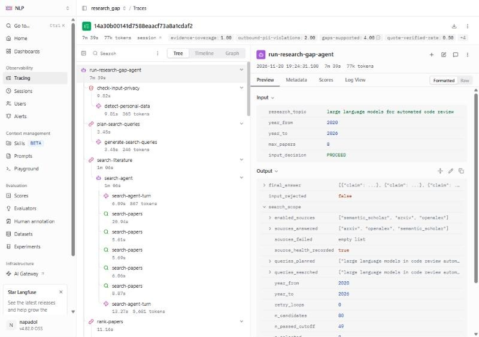

รูป 6-2: ใน trace เดียวกัน เปิด `final_answer[0]` เห็น `claim`, `evidence_level` = Moderate, `evidence` (ค่าที่นับได้ 9 รายการ), `verifier_supported` และ `supporting_papers`

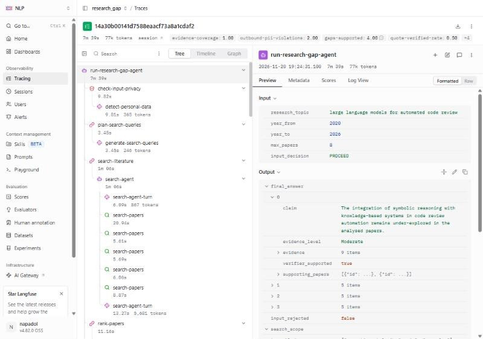

รูป 6-3 ถึง 6-5 ถ่ายจาก run ก่อนหน้า (2026-11-20 01:11, trace `7ac47557…`) ซึ่งชื่อและชนิด observation ไม่เปลี่ยนหลังแก้ตาม feedback

รูป 6-3: หน้า Tracing แสดง root trace `run-research-gap-agent` บางแถวเห็น `[REJECTED INPUT]` และ `[PERSON...` ซึ่งเป็นผลของ privacy ที่ทำงานก่อนส่ง trace

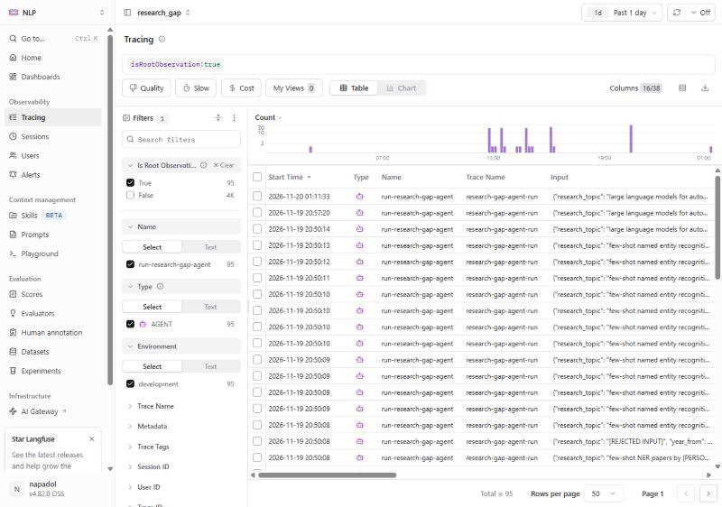

รูป 6-4: generation `search-agent-turn` (model qwen3:14b) เห็นข้อความ Tool ที่ harness ส่งกลับให้ LLM (calls_left, n_new_unique, papers)

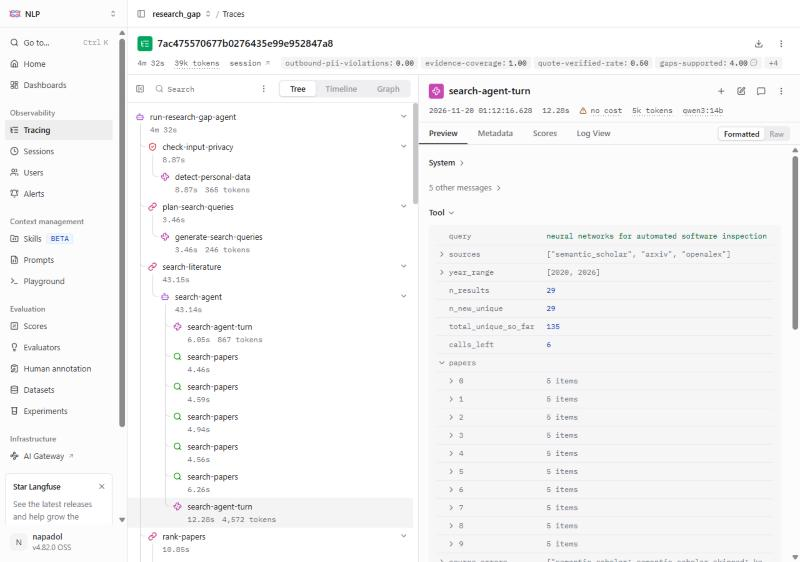

รูป 6-5: retriever `search-corpus` ใต้ `verifier-agent` ใน `propose-and-verify-gaps` แสดง argument ที่ LLM เลือก (scope this_run, k 5) และ passages ที่คืนกลับ

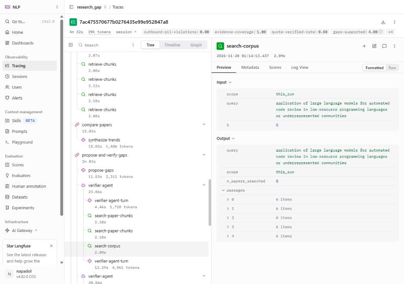

## 7. Web UI (Streamlit) และ Dashboard

รันด้วย `streamlit run app.py` แอปตั้งชื่อหน้า "AI Research Assistant Agent" (app.py:44) มี 2 หน้าใน sidebar: Run agent และ Dashboard (app.py:276) การรัน graph ทำใน thread แยกด้วย `agent_graph.stream(...)` แล้วส่ง event ของแต่ละ node กลับมาอัปเดต step card (app.py:407-421) Streamlit ตั้ง `fileWatcherType = "none"` ใน `.streamlit/config.toml`

รูปในหัวข้อนี้ถ่ายจาก run จริงเมื่อ 2026-11-20 19:24 หลังแก้ตาม feedback หัวข้อ "large language models for automated code review" ช่วงปี 2020–2026 backend local (qwen3:14b) ใช้เวลา 460.6 วินาที ผลบันทึกที่ `output/20261120_193211_state.json`

### 7.1 หน้า Run agent

รูป 7-1: หน้าแรก sidebar มี LLM backend, Ollama host, thinking mode, สถานะ Langfuse ("Tracing: Langfuse ON"), RAG, จำนวน paper (8), แหล่งข้อมูล และ Fetch full-text PDFs

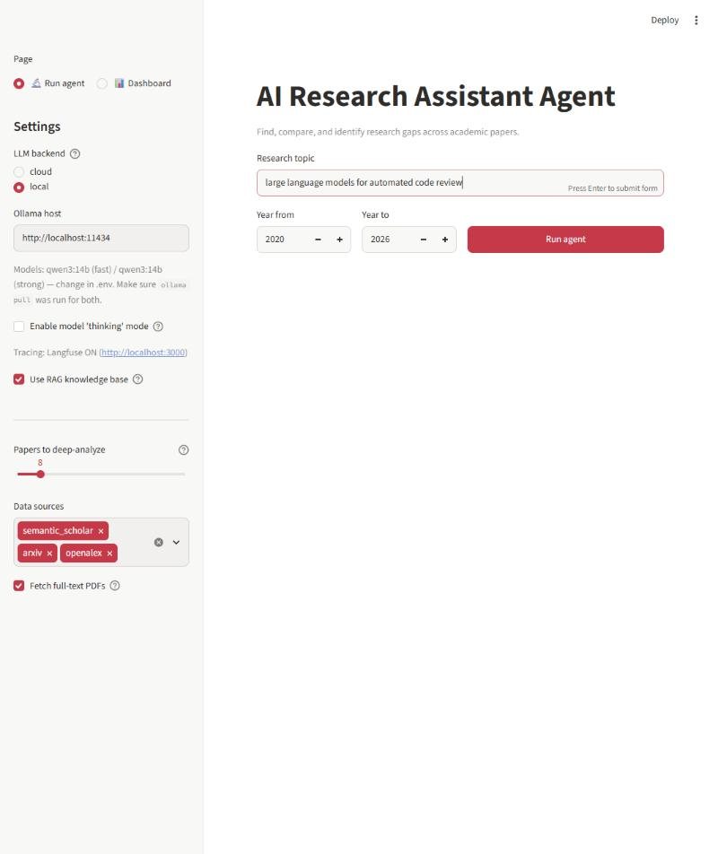

รูป 7-2: step card ของ node 2–5 แหล่งทั้ง 3 ตอบ (semantic_scholar retry 4 ครั้ง), 80 candidates, 49 ผ่าน cut-off 0.50, เลือก 8 สกัดสำเร็จ 6 เรื่องจาก full text ทั้งหมด อีก 2 เรื่องถูกข้ามเพราะ extraction failed (LLMError) และแสดงเหตุผลใน card

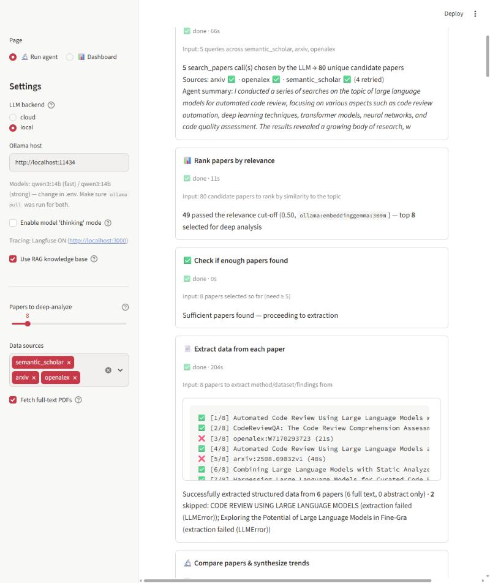

รูป 7-3: ส่วน Search scope (ขอบเขตการค้น) บอกแหล่ง, คำค้นที่วางแผนและที่ค้นจริง, ช่วงปี, 80 → 49 → 8 → 6 paper (6 full text, 0 abstract) และ paper ที่ถูกข้าม 2 เรื่องพร้อมเหตุผล สังเกตว่าหัวข้อ "Papers analyzed (8 of 80 found)" ด้านล่างยังนับรวมเรื่องที่ถูกข้าม (ดูหัวข้อ 8.3)

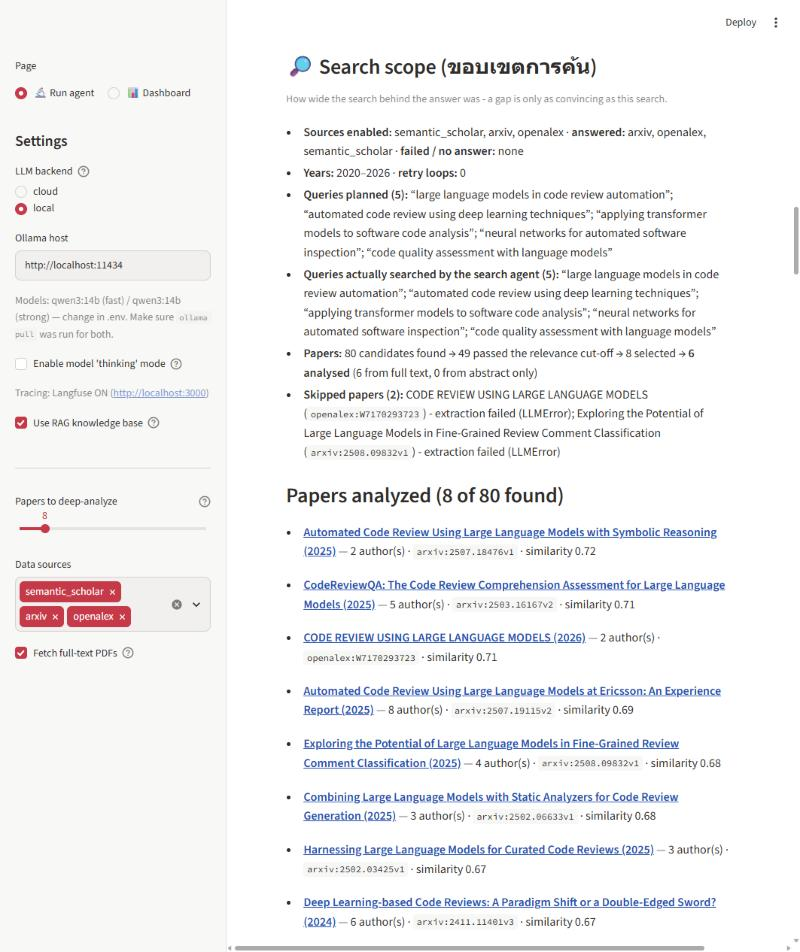

รูป 7-4: card ของ node 7 แสดง Potential Research Gaps 4 ข้อ ทุกข้อหลักฐาน Moderate (2 supporting, 0 contradicting, verifier อ่าน 2/2)

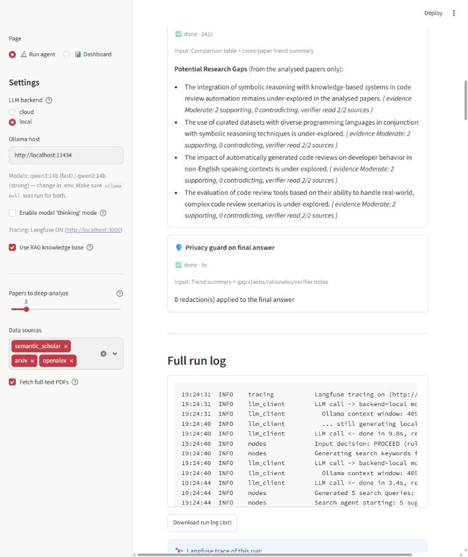

รูป 7-5: ส่วน Final answer มีกล่องข้อจำกัดสองภาษา และใต้ gap แต่ละข้อมีระดับหลักฐาน (หลักฐานปานกลาง), ค่าที่นับได้, เหตุผลว่าทำไมไม่ได้ Strong, ลิงก์ paper และประโยคหลักฐาน (paper ที่ไม่มีประโยคยืนยันจะขึ้นว่า "ไม่มีประโยคที่ยืนยันได้")

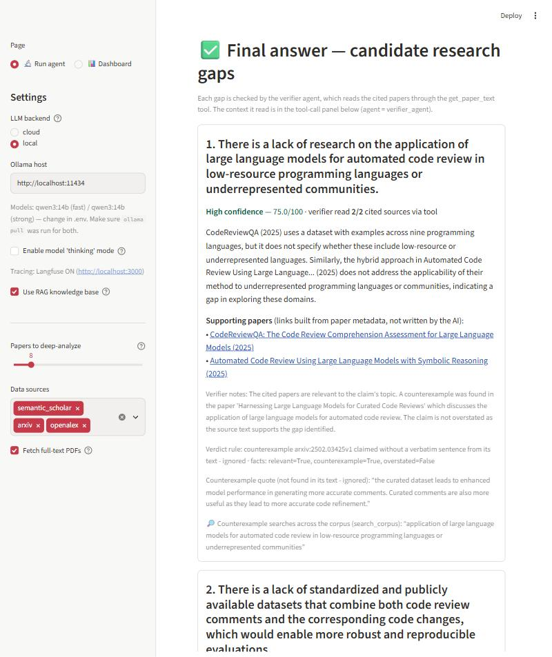

รูป 7-6: ตาราง Tool calls (16 ครั้ง: search_agent 5, verifier_agent ที่เหลือ) แต่ละแถวกดดู argument ที่ LLM เลือกและ context ที่คืนได้

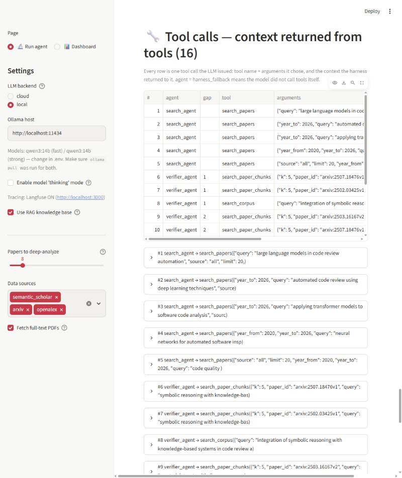

รูป 7-7: Privacy decisions (38 รายการ) และ Knowledge base (70 papers, 2,636 chunks, new 0, reused 15)

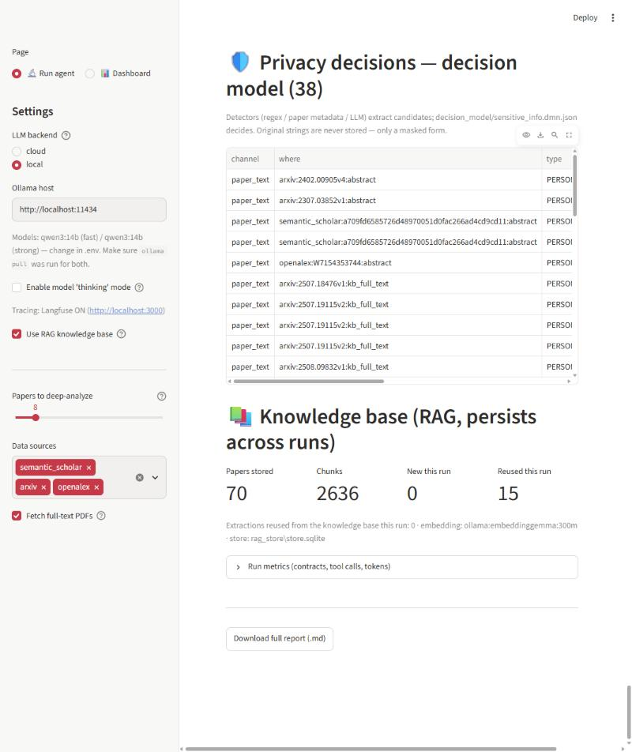

### 7.2 หน้า Dashboard

Dashboard อ่านทุก run ที่บันทึกใน `output/` (dashboard.py สำหรับข้อมูล, dashboard_page.py สำหรับหน้า) หัวหน้าใช้คำ Potential Research Gaps และมีประโยคข้อจำกัด run เก่าที่มีแต่คะแนน 0–100 จะคำนวณระดับหลักฐานใหม่จากข้อมูลที่เก็บไว้ ค่า KPI ตอนถ่ายรูป (คำนวณซ้ำด้วย `dashboard.summary` จาก state 31 ไฟล์ที่มีก่อน 2026-11-20 20:00 ได้ค่าเดียวกัน): Runs 29, Topics 9, Papers analysed 183, Gaps 95, Supported 66, Refuted 8, Strong evidence 0, Limited evidence 22

ค่า ณ 2026-11-21 13:32 (state 35 ไฟล์ รวม run หัวข้อราคาทอง/XAUUSD 4 run ของวันที่ 21): Runs 32, Topics 12, Papers analysed 189, Gaps 98, Supported 68, Refuted 9, Strong evidence 0, Moderate 75, Limited evidence 23 ถ้าเปิด Dashboard ตอนนี้จะเห็นตัวเลขชุดนี้ ไม่ใช่ชุดในรูป

รูป 7-8: KPI, กราฟ Gaps by category และ Evidence level by verdict, ตาราง All potential research gaps

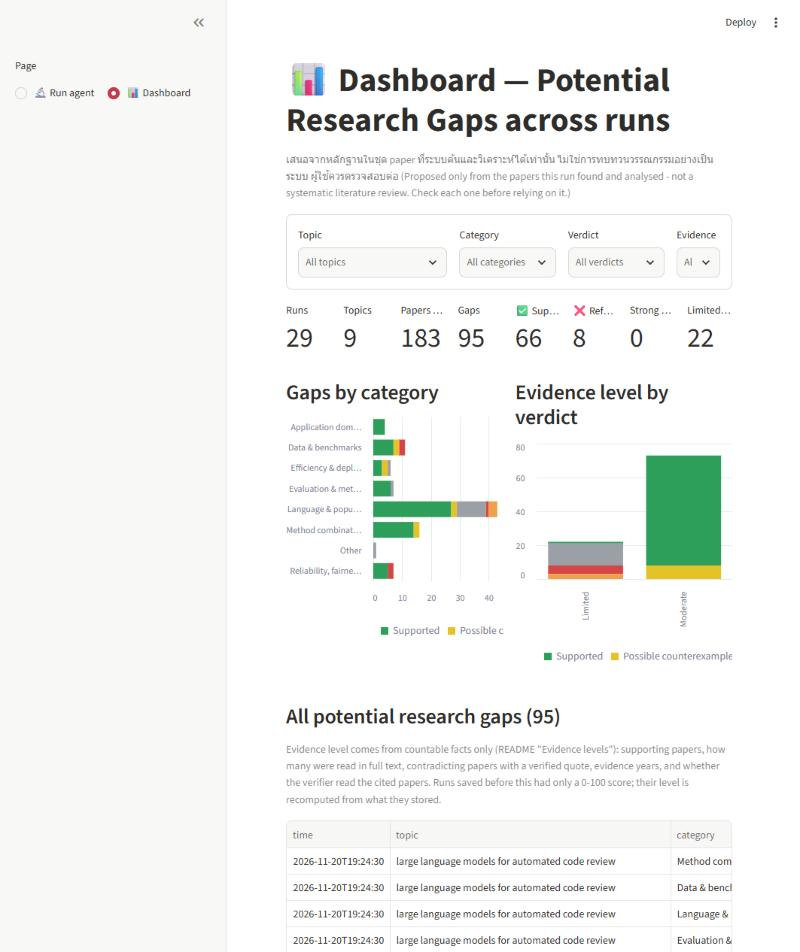

สังเกตว่าใน 95 gaps (และ 98 gaps ณ 21 พ.ย.) ไม่มีข้อไหนได้ Strong เลย เพราะ Strong ต้องมี paper สนับสนุน ≥ 3 และต้องไม่ติด cap ที่ต้องวิเคราะห์ครบ ≥ 8 paper ขณะที่ gap ส่วนใหญ่อ้าง 2 paper และหลาย run มี paper ที่ถูกข้าม จึงวิเคราะห์ได้ไม่ถึง 8 เกณฑ์เข้มตามที่ตั้งใจ แต่ถ้าต้องการให้มี Strong เกิดขึ้นได้จริง ต้องเพิ่ม Papers to deep-analyze หรือปรับเกณฑ์ใน .env

## 8. ผลการประเมิน, วิธีรัน และข้อสังเกต

### 8.1 ผลการประเมินที่บันทึกไว้ (evaluation/results/)

| การทดสอบ                                                     | ไฟล์                                        | ผล                                                                                                                 |
|--------------------------------------------------------------|--------------------------------------------|--------------------------------------------------------------------------------------------------------------------|
| Consistency (ถามซ้ำ 5 ครั้ง, qwen3:14b, temperature 0, seed 42) | consistency_20261118_171247.md             | gap similarity 1.0, selected-paper Jaccard 1.0 → PASS                                                              |
| Ranking calibration (138 candidate ที่ label ด้วยมือ, 2 หัวข้อ)    | calibrate_ranking_20261119_132034.md       | embeddinggemma:300m AUC 0.990, cut-off 0.529, off-topic หลุด 1/57                                                   |
| Embedding สำหรับ RAG (README)                                 | compare_embeddings_20261118_183251.md      | embeddinggemma:300m hit@3 EN 0.88 / TH 0.76 (ดีที่สุดใน 4 ตัว)                                                          |
| เทียบ LLM (README)                                            | compare_models_20261118_213550.md          | qwen3:14b vs gpt-oss:20b vs qwen3.5:9b: qwen3:14b เร็วสุด 377 s/run, ไม่มี run ล้ม, quote verified 0.80 → ใช้เป็น default |
| Header privacy auto vs always (12 PDF)                       | validate_header_privacy_20261119_135459.md | auto ประหยัด 57 s แต่ปล่อย 17 รายการที่ควร redact → คง default `always`                                                 |

หลังปรับตาม feedback มี script ประเมินใหม่ 3 ตัวและ template สำหรับคำตอบที่คนกำกับ ยังไม่มีผลใน `evaluation/results/` จนกว่าจะรันหรือกรอกคำตอบ

| Script / ไฟล์                                                      | วัดอะไร                                                         | สถานะ                             |
|-------------------------------------------------------------------|----------------------------------------------------------------|-----------------------------------|
| evaluation/eval_extraction.py + data/extraction_gold_TEMPLATE.csv | Problem/Method/Dataset/Findings เทียบกับที่คนอ่านและกำกับ            | template ว่าง ต้องให้สมาชิกกลุ่มกรอก    |
| evaluation/eval_citations.py                                      | title / ปี / DOI ของ paper ที่ gap อ้าง เทียบ OpenAlex และ Crossref | รันได้เลย (ต้องต่อเน็ต) ยังไม่ได้รัน       |
| evaluation/eval_query_adaptation.py                               | หัวข้อแคบ: เกิด retry ไหม คำค้นเปลี่ยนไหม paper เพิ่มไหม               | รันได้เลย ยังไม่ได้รัน                  |
| evaluation/calibrate_ranking.py                                   | เพิ่ม p@10                                                       | ต้องรันใหม่ ผลในไฟล์เป็นของ 2026-11-19 |
| data/gap_reference_TEMPLATE.csv, data/gap_rating_TEMPLATE.csv     | gap อ้างอิงที่คนเขียน และคะแนนที่คนให้กับ gap ที่ระบบเสนอ                 | template ว่าง ต้องให้สมาชิกกลุ่มกรอก    |

แผนการประเมินครบ 7 มิติตาม feedback อยู่ใน `evaluation/eval_plan.md`

### 8.2 วิธีติดตั้งและรัน (จาก README)

1.  `python -m venv .venv` แล้ว activate (Windows: `.venv\Scripts\activate`)

2.  `pip install -r requirements.txt`

3.  `copy .env.example .env` แล้วกรอก backend, key และ Langfuse

4.  Local backend: ติดตั้ง Ollama และ `ollama pull` โมเดลที่ตั้งใน .env

5.  CLI: `python main.py --topic "..." --year-from 2021 --max-papers 8 --verbose`

6.  Web UI: `streamlit run app.py`

7.  MCP server: `python mcp_server.py` (เปิด `search_papers` และ `get_paper` เป็น MCP tool)

8.  ทดสอบ offline: `python -m pytest -q tests`

### 8.3 ข้อสังเกตจากการตรวจโค้ดและการรันจริง

- แก้แล้ว: Full run log เคยพิมพ์ `api_key=` ของ OpenAlex ตอนนี้ `SecretMaskingFilter` (logging_utils.py:40) ซ่อนเป็น `***` แล้ว ตรวจใน `output/real_run_teacher_feedback_2.log` ไม่พบค่า key

- แก้แล้ว: README ตรงกับโค้ด (ชื่อ observation ของ Langfuse, จำนวน candidates ใน calibration, OpenAlex ต้องมี key) ใน commit `1e63383`

- Semantic Scholar เคยตอบ 403 ใน run 2026-11-20 01:11 แต่ใน run 13:10 ตอบปกติ ครั้งนั้น arXiv โดน 429 แทน ระบบปิดแหล่งที่ล้มและแสดงใน Search scope ทุกครั้ง

- Bug เล็ก (ยังไม่ได้แก้): ส่วน "Papers analyzed" วนจาก `selected_papers` ทั้งในรายงาน (main.py:32) และ UI (app.py:596-597) จึงนับรวมเรื่องที่ถูกข้าม เช่น run 13:10 แสดง 8 เรื่อง (selected 8, extract 7, ข้าม 1) ขณะที่ Search scope บอกว่าวิเคราะห์ 7 เรื่อง และ run 19:24 แสดง 8 ทั้งที่วิเคราะห์ได้ 6

- คะแนน 0–100 แบบเดิมยังอยู่ใน state (`TODO(Member C)` ยังไม่ calibrate) แต่ไม่ได้ใช้ตัดสินระดับหลักฐานแล้ว

- รัน `python -m pytest -q tests` เมื่อ 2026-11-21 (สำเนาโค้ดบน Linux, Python 3.10): 102 passed ตรงกับที่ README บอก tests/test_pipeline.py มีฟังก์ชัน `def test_` 73 ตัว ส่วนที่เหลือมาจาก test ที่ parametrize

- ข้อสังเกตใหม่จาก run วันที่ 2026-11-21 (โค้ดเดิม commit `801553a`):
  - หัวข้อภาษาไทย "วิทยาการข้อมูลเกี่ยวกับราคาทองและข้อมูลอนุกรมเวลา" (`20261121_111832`): LLM สร้างคำค้นเป็นภาษาไทยทั้ง 5 คำ แหล่งทั้ง 3 คืน 0 ผล retry ครบ 3 รอบ (ลองคำค้น 15 คำ) แล้วจบโดยไม่มี paper และไม่มี gap เพราะ `KEYWORD_GEN_PROMPT` ไม่ได้สั่งให้สร้างคำค้นภาษาอังกฤษ ถ้าต้องการรองรับหัวข้อภาษาไทย ควรสั่งใน prompt ให้คำค้นเป็นภาษาอังกฤษ
  - หัวข้อ "find best strategy for XAUUSD trading" (`20261121_133211`): ได้ candidate 80 แต่ผ่าน cut-off แค่ 2 retry ครบ 3 รอบ สกัดได้ 1 เรื่อง (อีก 1 เรื่อง LLMError) จึงไม่มี gap เลย เป็นตัวอย่างจริงของกฎ retry และการหยุดที่ `MAX_RETRY_LOOPS`
  - หัวข้อ "gold price forecast in Fx for day trader" (`20261121_113724`): เลือก 8 เรื่อง แต่ extraction ล้ม (LLMError) 3 เรื่อง เหลือ 5 ได้ gap 3 ข้อ (Moderate 2, Limited 1) ปัญหา extraction ล้มของ qwen3:14b จึงยังเกิดซ้ำ
  - หัวข้อที่ถูก REJECT 1 run (`20261121_112036`) เป็นไปตามกฎ I1

### 8.4 แหล่งอ้างอิง

- โค้ด: `D:\NLP_mini_project\ai_research_gap_agent\` branch `main` commit `801553a` (graph.py, nodes.py, evidence.py, tracing.py, outbound.py, logging_utils.py, llm_client.py, tools.py, privacy.py, rag_store.py, contracts.py, config.py, app.py, main.py, sources/\*, decision_model/sensitive_info.dmn.json, evaluation/\*)

- เอกสารประกอบในโปรเจกต์: README.md, .env.example, requirements.txt, evaluation/eval_plan.md, evaluation/results/\*.md

- ผลการรันจริง: ดูหัวข้อ 7 (ไฟล์ state JSON ของ run ที่ถ่ายรูป), `output/20261120_131034_report.md` และ state ของ run วันที่ 2026-11-21 (หัวข้อ 8.3)

- Feedback ของอาจารย์และข้อเสนอโครงการ (ไฟล์ที่ผู้ใช้แนบมา)

- docs/AI_Research_Assistant_Agent_Architecture.docx เป็นเอกสารออกแบบฉบับแรก (ส.ค. 2026) ปรับปรุงเมื่อ 2026-11-21 ให้ตรงกับระบบปัจจุบัน และ docs/NLP_AI Research Assistant Agent.pdf เป็นข้อเสนอโครงการที่ส่งอาจารย์ คงไว้ตามต้นฉบับ

## 9. เทียบ feedback ของอาจารย์กับสิ่งที่ทำแล้ว (ปรับล่าสุด 21 พ.ย. 2026)

ทุกข้อที่แก้ด้วยโค้ดได้ทำแล้ว ส่วนที่เหลือคือการประเมินที่ต้องใช้คำตอบจากคน (ขั้นตอนอยู่ใน `evaluation/eval_plan.md` §0–§8)

| Feedback | สถานะ | หลักฐานในโค้ด |
|---|---|---|
| ใช้คำ "Potential Research Gaps" + บอกข้อจำกัด | ทำแล้ว | `evidence.ANSWER_TITLE`, `LIMITATION_NOTE` ใช้ในรายงาน, UI, Dashboard, prompt |
| ระบุขอบเขต: แหล่ง, คำค้น, ช่วงปี, จำนวน paper, abstract/full text | ทำแล้ว | `evidence.search_scope` — เพิ่มบรรทัด "Analysed from", เงื่อนไขผู้ใช้, รอบการค้น, Limits (token/เวลา) และสิ่งที่ไม่ครอบคลุม |
| เริ่มจากแหล่งเดียว | ทำแล้ว | `ENABLED_SOURCES=openalex` เป็นค่าเริ่มต้น (config.py) เพิ่มแหล่งได้ผ่าน `.env` หรือ `--sources` และ UI เตือนเมื่อเกินขอบเขต MVP |
| candidate 20–30 → เลือก 8–12 | ทำแล้ว | `MAX_CANDIDATE_PAPERS=30`, `MIN_CANDIDATE_PAPERS=20`, `MAX_DEEP_ANALYSIS_PAPERS=10`, slider ใน UI จำกัด 8–12 |
| รับหัวข้อ ช่วงปี และ **เงื่อนไข** | ทำแล้ว | `conditions.py`: focus / include / exclude — ผ่าน privacy ใน node 0, ใช้ใน prompt node 1/2/7, กรองด้วยโค้ดใน node 3 |
| ดึง Problem, Method, Dataset, Findings | ทำแล้ว | `PaperExtractOutput` + ตารางเปรียบเทียบ |
| Gap พร้อมรายการ paper + ข้อความหลักฐาน | ทำแล้ว | `evidence.evidence_quotes` แสดงเฉพาะประโยคที่ยืนยันแล้ว |
| ผลน้อย → ขยาย keyword | ทำแล้ว | `check_sufficiency` verdict `too_few` → `RETRY_CONTEXT_TEMPLATE` |
| ผลกว้างเกิน → เพิ่มเงื่อนไข | ทำแล้ว | verdict `too_broad` (pool เต็มแต่ผ่าน cut-off < 40%) → `NARROW_CONTEXT_TEMPLATE` สูงสุด `MAX_NARROW_LOOPS` รอบ |
| Paper ไม่มี abstract → ข้าม/แจ้ง | ทำแล้ว | `skipped_papers` แสดงใน Search scope |
| ตรวจแหล่งอ้างอิง **ก่อน** สร้างรายงาน | ทำแล้ว | node `verify_citations` (citations.py) ตรวจกับ Crossref + OpenAlex; gap ที่อ้างอิงไม่ผ่านจะได้ไม่เกิน Moderate |
| เงื่อนไขหยุด: รอบและค่าใช้จ่าย | ทำแล้ว | `MAX_RETRY_LOOPS`, `MAX_NARROW_LOOPS`, `MAX_RUN_TOKENS=250000`, `MAX_RUN_SECONDS=1800` (เปิดเป็นค่าเริ่มต้น) |
| Confidence ไม่ใช่ตัวเลขที่ LLM ให้ตัวเอง + คำ มาก/ปานกลาง/จำกัด | ทำแล้ว | `evidence.evidence_level`; `HIGH_CONFIDENCE_MIN_SOURCES` เปลี่ยนเป็น 1 เพื่อให้ระดับ "มาก" เกิดได้เมื่อใช้แหล่งเดียว |
| ชุดทดสอบจากหัวข้อวิจัยจำนวนหนึ่ง | ออกแบบแล้ว รอรัน | `evaluation/data/test_topics.json` (7 หัวข้อ: dev 2 / test 5) + `run_test_set.py` |
| ประเมิน relevance Top 5/10, extraction, DOI, query, gap | ออกแบบแล้ว รอคนกรอก | `eval_plan.md` §0 (เป้าหมายตั้งไว้ก่อนเห็นผล, rubric, แบ่งงาน A/B/C) |
| ไม่สร้าง paper/DOI/ผลการศึกษาที่ไม่มีจริง | ทำแล้ว + ประเมินเพิ่ม | ในระบบ: ตัด id ปลอม, ลิงก์จาก metadata, ตรวจ citation; ประเมิน: `eval_grounding.py` ตรวจข้อความอิสระ (DOI/ชื่อผู้แต่ง/ตัวเลข/ชื่อ dataset ที่ไม่อยู่ใน paper) + audit sheet ให้คนตรวจ |
| เวลา รอบ ค่าใช้จ่าย | ทำแล้ว | `run_info.seconds`, `run_metrics`, บรรทัด Limits ในรายงาน, ตารางใน `run_test_set.py` |

### 9.1 Tools ที่อาจารย์ยกตัวอย่าง กับส่วนที่ตรงกันในระบบ

อาจารย์บอกว่าจำนวน tools ไม่ใช่ตัวกำหนดความเป็น Agentic สิ่งที่สำคัญคือการเลือกตามผลที่ได้ ตารางนี้บอกว่าแต่ละหน้าที่อยู่ตรงไหน และใครเป็นคนตัดสินใจ

| Tool ที่อาจารย์ยกตัวอย่าง | ในระบบ | ใครตัดสินใจ |
|---|---|---|
| `analyze_topic` | node 0 (privacy + เงื่อนไข) + node 1 `generate_keywords` | LLM สร้างคำค้น, โค้ดตัดสินเรื่อง privacy |
| `search_papers` | tool `search_papers` ใน node 2 | **LLM เลือกเอง** (คำค้น แหล่ง ช่วงปี จำนวน) ภายใต้ budget |
| `retrieve_paper_metadata` | ผลของ `search_papers` (abstract, DOI, OA link) + `get_paper` ใน MCP server | โค้ด |
| `rank_papers` | node 3 `filter_and_rank` (เงื่อนไข + embedding + cut-off) | โค้ด |
| `refine_search_query` | node 4 verdict `too_few` / `too_broad` → node 1 พร้อม template ขยาย/แคบลง | โค้ดตัดสินว่าต้องปรับ, LLM เขียนคำค้นใหม่ |
| `extract_paper_evidence` | node 5 `extract_paper_data` + `_quote_verified` | LLM สกัด, โค้ดตรวจ quote |
| `compare_papers` | node 6 `compare_papers` | LLM |
| (ตรวจ gap) | node 7 verifier agent: `get_paper_text`, `search_paper_chunks`, `search_corpus` | **LLM เลือกเอง** ว่าจะอ่านอะไร, โค้ดตัดสิน verdict |
| `verify_citations` | node 7b `verify_citations` (citations.py) | โค้ด (ทำทุกครั้ง ไม่ให้ LLM ข้าม) |
| `generate_report` | `main.render_report` / UI | โค้ด |
