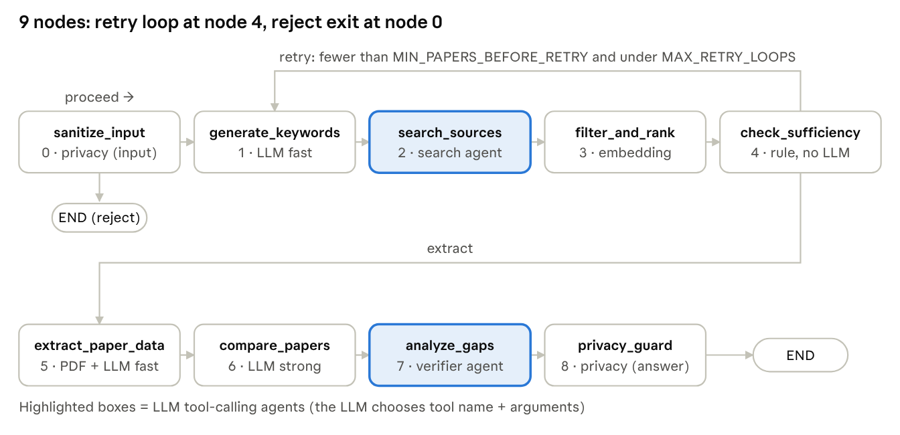
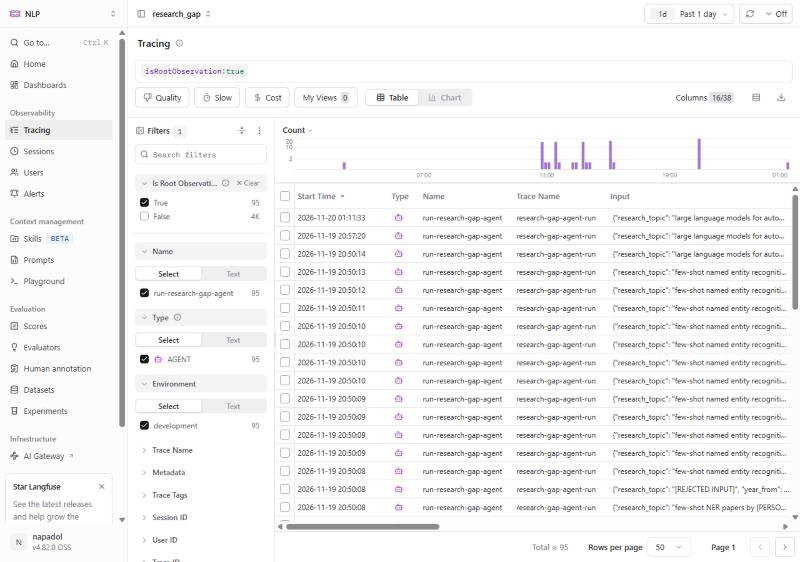
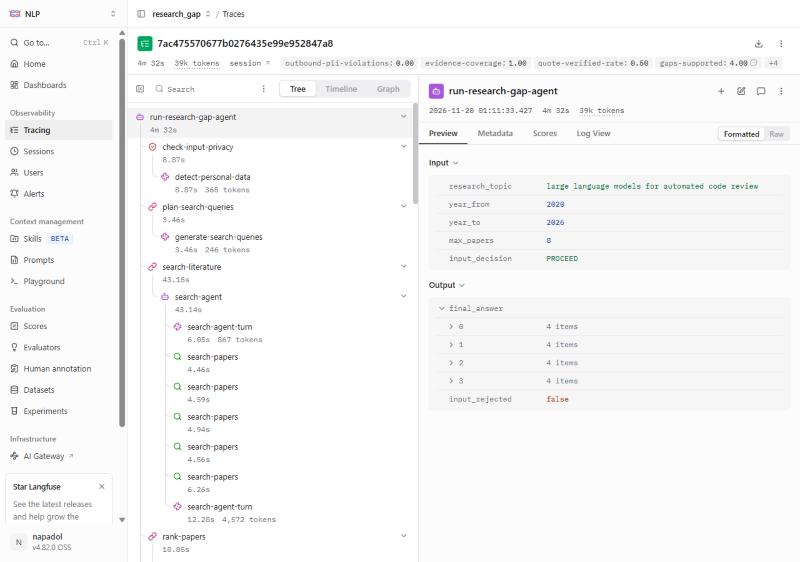
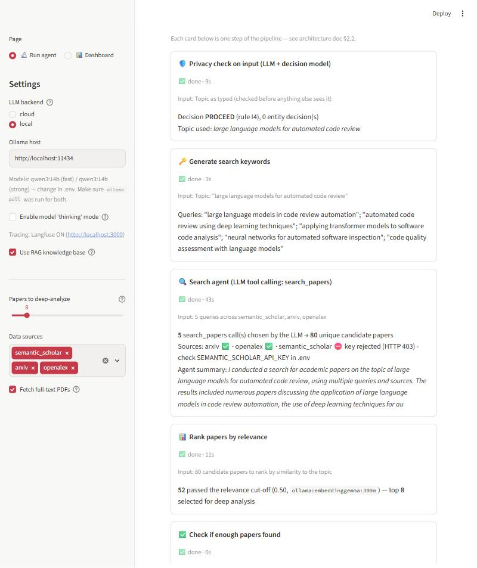
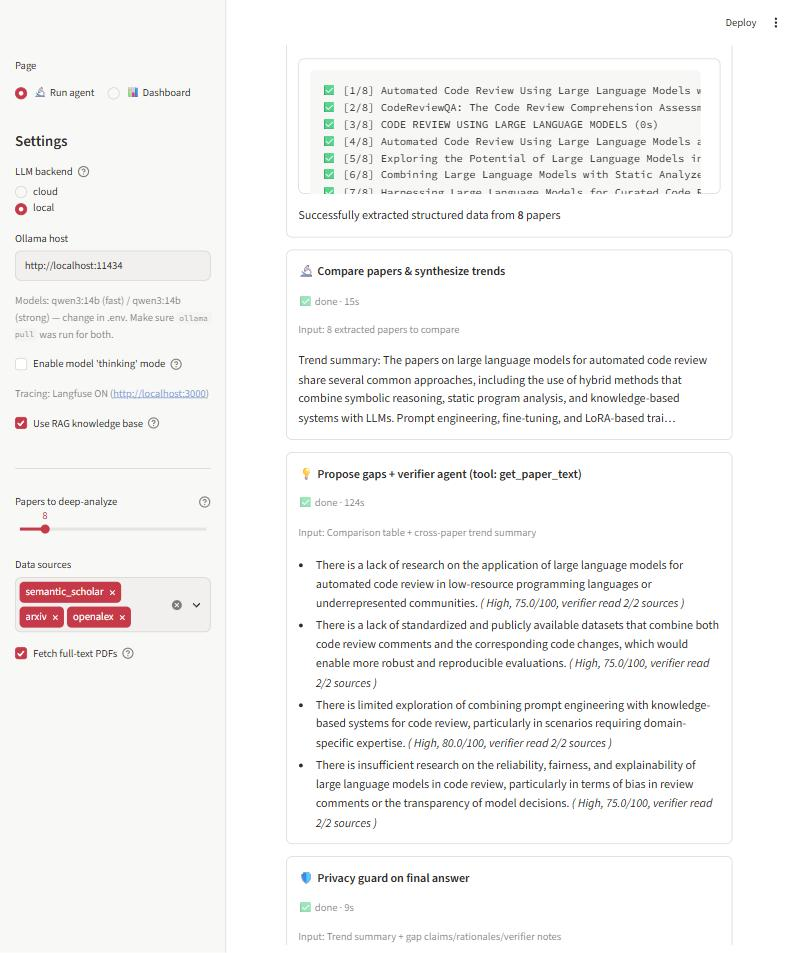
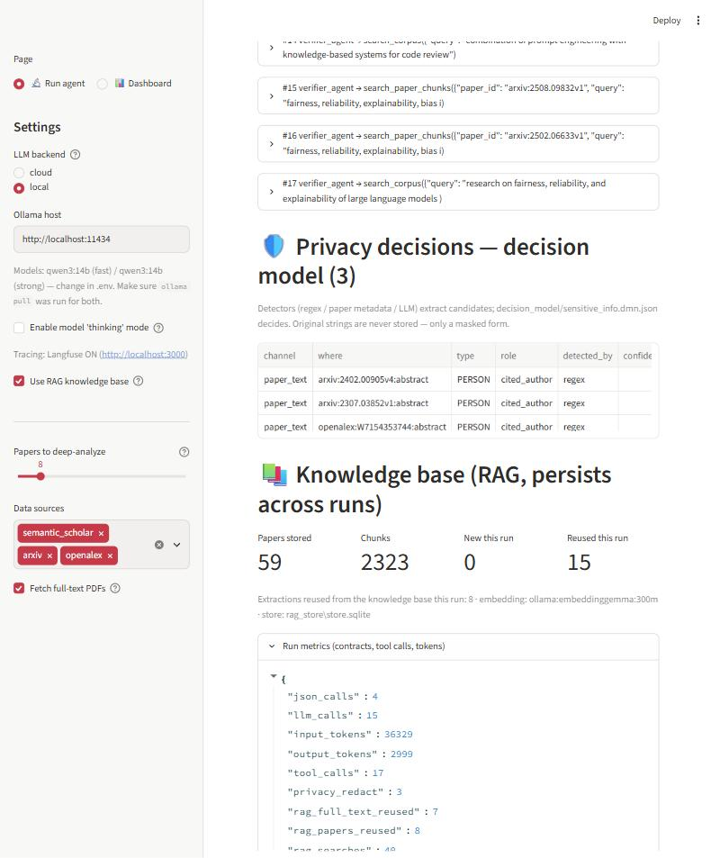
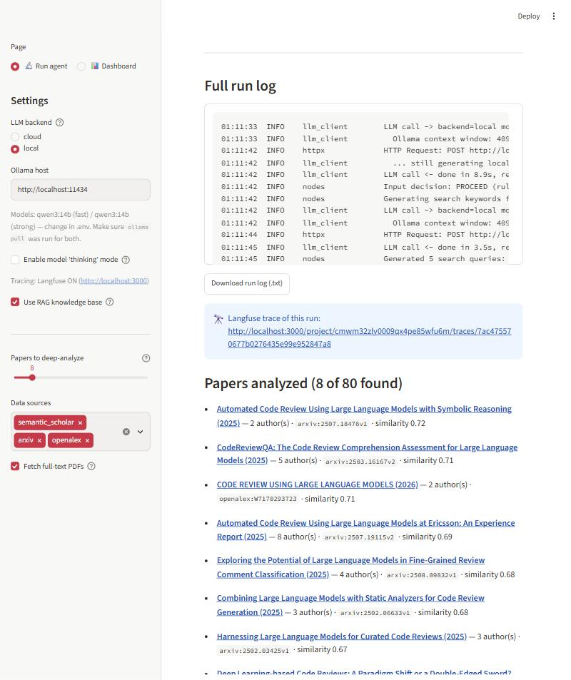
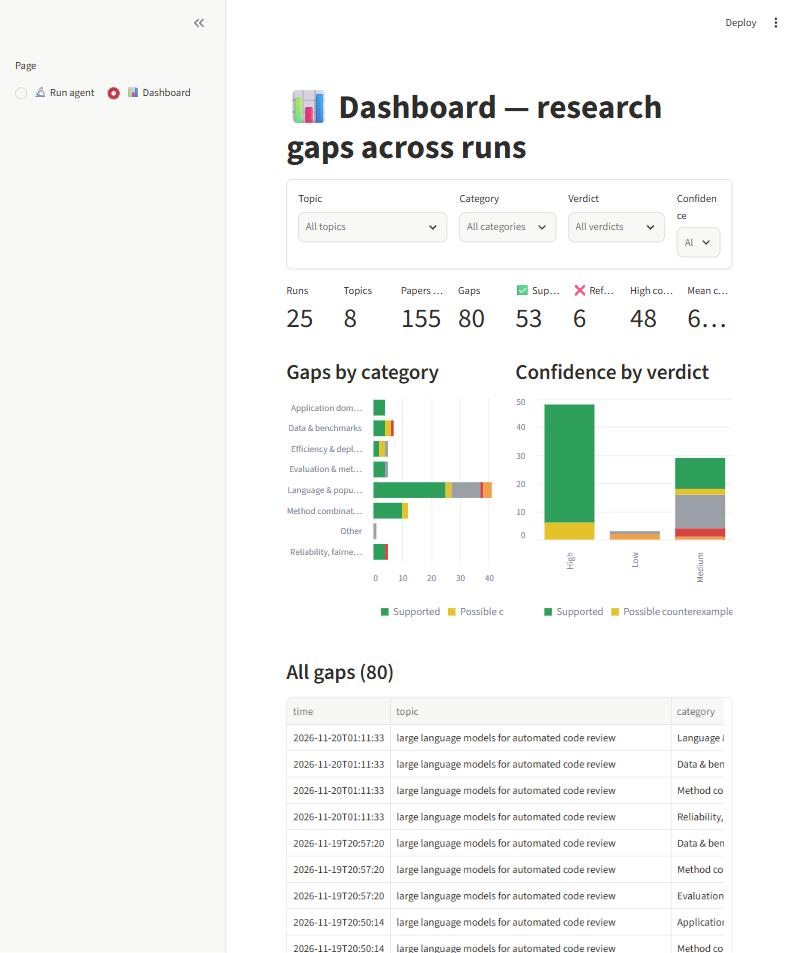
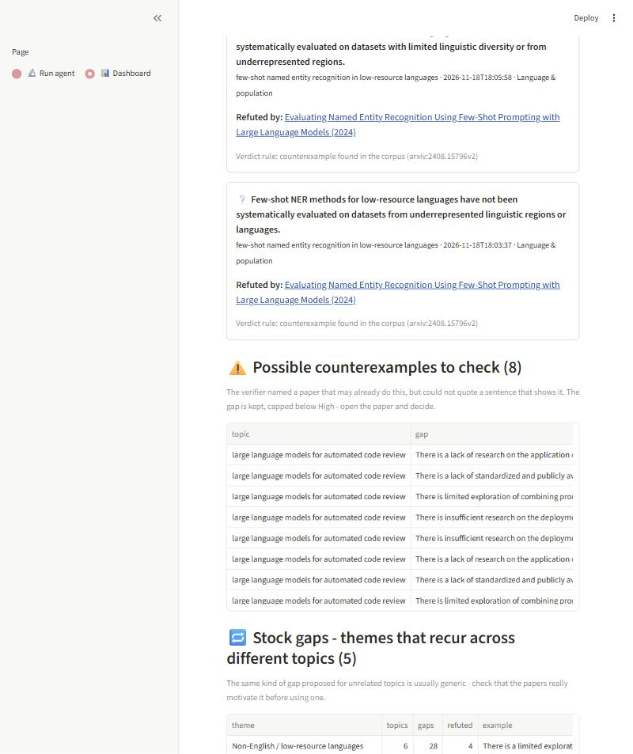

# AI Research Gap Agent — เอกสารอธิบายโปรเจกต์

2026-11-20

ทุกข้อมูลในเอกสารนี้อ้างอิงจากโค้ดในโฟลเดอร์ D:\NLP_mini_project\ai_research_gap_agent และจากการรันแอปจริง

## 1. ภาพรวมโปรเจกต์

ระบบนี้คือ AI agent ที่รับหัวข้อวิจัย 1 หัวข้อ แล้วคืน "Research Gap" 2–4 ข้อ ที่อ้างอิงเปเปอร์จริงพร้อมคะแนนความมั่นใจ 0–100 ตาม README.md: ค้นแหล่งวิชาการ → คัดเปเปอร์ที่เกี่ยวข้อง → สกัดข้อเท็จจริงจากแต่ละเปเปอร์ (อ่าน PDF ฉบับเต็มได้) → เปรียบเทียบ → เสนอ gap → ตรวจสอบ gap กับต้นฉบับ

| หัวข้อ            | รายละเอียด                                                                                   | แหล่งอ้างอิง                                                              |
|-----------------|---------------------------------------------------------------------------------------------|------------------------------------------------------------------------|
| Input           | หัวข้อวิจัย, ช่วงปี (year_from/year_to), จำนวนเปเปอร์ที่วิเคราะห์เชิงลึก                                 | main.py:114 `run()`, แฟล็ก `--topic --year-from --year-to --max-papers` |
| Output          | รายงาน Markdown `output/<timestamp>_report.md` + state JSON `output/<timestamp>_state.json` | main.py:144 `save_outputs()`                                           |
| แหล่งเปเปอร์      | Semantic Scholar, arXiv, OpenAlex (+ PDF open-access)                                       | sources/semantic_scholar.py, arxiv.py, openalex.py, pdf_extract.py     |
| Orchestration   | LangGraph `StateGraph` 9 nodes                                                              | graph.py                                                               |
| LLM             | 2 backend: cloud (Anthropic) / local (Ollama) แบ่งเป็น tier fast/strong                       | llm_client.py, .env.example                                            |
| ค่าที่ใช้จริงในเครื่อง | `LLM_BACKEND=local`, qwen3:14b ทั้ง fast และ strong, Langfuse ที่ `http://localhost:3000`       | .env (บรรทัด 2, 74), output/20261119_210348_state.json `run_info`       |
| UI              | Streamlit 2 หน้า: Run agent และ Dashboard                                                    | app.py:269, dashboard_page.py                                          |
| Observability   | Langfuse (optional, ปิดอัตโนมัติถ้าไม่มี key)                                                      | tracing.py, outbound.py                                                |

ไลบรารีหลักจาก requirements.txt: langgraph\>=0.2.0, langchain-core, anthropic\>=0.40.0, httpx, sentence-transformers\>=3.0.0, numpy, pydantic\>=2.8.0, mcp\>=1.0.0, tenacity, streamlit\>=1.50.0, pymupdf4llm==0.0.17, pytest, langfuse\>=3.0.0

โครงสร้างไฟล์หลัก (จำนวนบรรทัดจาก `wc -l`):

| ไฟล์                              | บรรทัด     | หน้าที่                                |
|----------------------------------|-----------|-------------------------------------|
| nodes.py                         | 690       | 9 graph nodes                       |
| app.py                           | 678       | Streamlit web UI                    |
| llm_client.py                    | 570       | LLM wrapper + tool-calling loop     |
| privacy.py                       | 423       | detector + redaction                |
| tracing.py                       | 363       | Langfuse tracing                    |
| tools.py                         | 308       | tool spec + executor                |
| dashboard.py / dashboard_page.py | 234 / 170 | หน้า Dashboard                       |
| rag_store.py                     | 227       | RAG knowledge base (SQLite + numpy) |
| embeddings.py                    | 188       | embedding + ranking                 |
| prompts.py                       | 184       | prompt ทุกตัว                         |
| main.py                          | 183       | CLI entrypoint                      |
| config.py                        | 177       | ค่า config ทั้งหมด                     |
| contracts.py                     | 167       | pydantic contracts                  |
| state.py                         | 106       | `AgentState` schema                 |
| outbound.py                      | 68        | outbound PII contract               |
| graph.py                         | 57        | ต่อ node เป็น graph                   |

## 2. สถาปัตยกรรม (LangGraph)

ทั้งระบบเป็น LangGraph `StateGraph` เดียว มี 9 nodes และ conditional edge 2 จุด ทุก node ถูกห่อด้วย `tracing.wrap_node()` ก่อนใส่เข้า graph เพื่อส่ง trace ไป Langfuse



กล่องที่เน้นสีคือ node ที่ให้ LLM เลือกเรียก tool เอง (search agent ใน node 2, verifier agent ใน node 7) ส่วน node 4 ไม่เรียก LLM เลย

``` python
# graph.py:22-57 (ตัดมาบางส่วน)
def build_graph():
    graph = StateGraph(AgentState)
    graph.add_node("sanitize_input", tracing.wrap_node("sanitize_input", nodes.sanitize_input))
    ...
    graph.set_entry_point("sanitize_input")
    graph.add_conditional_edges("sanitize_input", nodes.route_after_input,
                                {"proceed": "generate_keywords", "reject": END})
    ...
    graph.add_conditional_edges(
        "check_sufficiency",
        nodes.route_after_sufficiency,
        {"retry": "generate_keywords", "extract": "extract_paper_data"},
    )
    graph.add_edge("extract_paper_data", "compare_papers")
    graph.add_edge("compare_papers", "analyze_gaps")
    graph.add_edge("analyze_gaps", "privacy_guard")
    graph.add_edge("privacy_guard", END)
    return graph.compile()
```

State ที่ไหลผ่าน graph คือ `AgentState` (TypedDict, state.py:56) ประกอบด้วย `Paper` (state.py:11), `PaperExtract` (state.py:26) และ `GapCandidate` (state.py:41) แต่ละ node รับ state ทั้งก้อนแต่คืนเฉพาะ key ที่เปลี่ยน (dict) ตามแบบมาตรฐานของ LangGraph

## 3. รายละเอียดแต่ละ node (nodes.py)

ทุก node อยู่ใน nodes.py ตารางนี้บอกบรรทัดที่ฟังก์ชันเริ่ม สิ่งที่ทำ และ key ที่เขียนกลับเข้า state

| \#  | ฟังก์ชัน (บรรทัด)              | สิ่งที่ทำ                                                                                                                                                             | เขียนลง state                                                   |
|-----|----------------------------|-------------------------------------------------------------------------------------------------------------------------------------------------------------------|----------------------------------------------------------------|
| 0   | `sanitize_input` (54)      | ตรวจหัวข้อที่พิมพ์ด้วย `privacy.sanitize_topic()` → decision model ตัดสิน PROCEED / PROCEED_REDACTED / REJECT; `route_after_input` (76) ส่งไป END ถ้า REJECT                 | `research_topic` (ฉบับ redact), `input_decision`, `privacy_log` |
| 1   | `generate_keywords` (83)   | LLM tier fast + `KeywordOutput` contract สร้าง 3–5 query; ตอน retry ต่อ `RETRY_CONTEXT_TEMPLATE` เพื่อเลี่ยง query เดิม                                                  | `search_queries`, `prior_queries_tried`                        |
| 2   | `search_sources` (108)     | search agent: LLM เรียก tool `search_papers` ผ่าน `llm_client.run_tool_loop`; ผลทุกชิ้นผ่าน `privacy.scrub_paper`                                                       | `candidate_papers`, `search_summary`, `tool_trace`             |
| 3   | `filter_and_rank` (163)    | จัดอันดับด้วย cosine similarity (`embeddings.rank_by_similarity`) ตัดด้วย threshold ต่อโมเดล แล้วเลือก top `max_papers`                                                    | `ranked_papers`, `selected_papers`                             |
| 4   | `check_sufficiency` (185)  | กฎเดียว ไม่ใช้ LLM: `need = min(MIN_PAPERS_BEFORE_RETRY, max_papers)`; `route_after_sufficiency` (197) ตัดสิน retry/extract                                            | `sufficient`, `retry_count`                                    |
| 5   | `extract_paper_data` (252) | ดึง PDF open-access → Markdown (ถ้ามี) แล้ว LLM tier fast สกัด method/dataset/findings/limitations/metrics + `supporting_quote`; ตรวจ quote ด้วย `_quote_verified` (40) | `paper_extracts`                                               |
| 6   | `compare_papers` (395)     | สร้างตารางเปรียบเทียบจาก extract แล้ว LLM tier strong สังเคราะห์แนวโน้ม                                                                                                  | `comparison_table`, `trend_summary`                            |
| 7   | `analyze_gaps` (526)       | เสนอ gap (`GAP_ANALYSIS_PROMPT`), ตัด id ที่ไม่มีจริง, บังคับ ≥ 2 เปเปอร์, แล้วส่ง verifier agent (`_verify_with_tools`, 464) อ่านต้นฉบับผ่าน tool                               | `gap_candidates`, `tool_trace`                                 |
| 8   | `privacy_guard` (657)      | ตรวจคำตอบสุดท้าย (trend summary + gaps) ด้วย detector + decision model แล้ว redact                                                                                    | ฟิลด์คำตอบที่ redact แล้ว                                           |

### การตรวจสอบข้อเท็จจริง (fact-checking)

มี 2 ชั้น ทั้งคู่เป็นโค้ดตัดสิน ไม่ใช่ LLM ตัดสินเอง:

1.  Extraction-quote grounding (node 5): LLM ต้องคืน `supporting_quote` ที่คัดลอกจากเนื้อหา แล้วเทียบแบบ substring หลังจัด whitespace ไม่มี LLM call เพิ่ม

2.  Verifier (node 7): LLM รายงาน facts (เกี่ยวข้องไหม, มี counterexample ไหม, overstated ไหม) แล้ว `verifier_decision()` (nodes.py:438) ตัดสิน counterexample จะนับก็ต่อเมื่อมีประโยคที่คัดมาตรงตัว ≥ 30 ตัวอักษร (`MIN_COUNTEREXAMPLE_QUOTE_CHARS`) จากเนื้อหาที่ tool คืนมาจริง

``` python
# nodes.py:40-48
def _quote_verified(quote: str, source_text: str) -> bool:
    quote = (quote or "").strip()
    if not quote:
        return False
    return _normalize_whitespace(quote) in _normalize_whitespace(source_text)
```

### สูตรคะแนนความมั่นใจของ gap (nodes.py:585-613)

| ส่วนประกอบ   | คะแนนสูงสุด | วิธีคิด                                                                                   |
|-------------|-----------|----------------------------------------------------------------------------------------|
| จำนวนหลักฐาน | 40        | `min(len(supporting_ids) / 4, 1.0) * 40`                                               |
| ความใหม่     | 30        | `max(30 - age * 5, 5)` จากปีของเปเปอร์ใหม่สุด; ไม่มีปี = 10                                   |
| Verifier    | 30        | supported + อ่าน ≥ 50% ของเปเปอร์ที่อ้าง = 30, supported แต่อ่านน้อยกว่า = 15, ไม่ supported = 5 |

High ≥ 75, Medium ≥ 45, นอกนั้น Low ถ้าเข้าเงื่อนไข `_confidence_caps` (วิเคราะห์ \< `HIGH_CONFIDENCE_MIN_PAPERS`=8 เปเปอร์ หรือแหล่งที่ตอบ \< 2) คะแนนจะถูกจำกัดที่ 70 (`CONFIDENCE_CAP_SCORE`) ในโค้ดมี `TODO(Member C)` ระบุว่าสูตรนี้เป็น heuristic รอบแรก ยังไม่ได้ calibrate

## 4. แหล่งข้อมูล, tool calling, LLM client และ contracts

### 4.1 แหล่งเปเปอร์ (sources/)

แหล่งทั้ง 3 ลงทะเบียนใน `REGISTRY` (`sources/__init__.py:27`) แต่ละตัวมี interface เดียวกัน: `search_papers` / `get_paper` / `get_full_text`

| แหล่ง             | Endpoint (จากโค้ด)                                                  | หมายเหตุ                                                                     |
|------------------|--------------------------------------------------------------------|-----------------------------------------------------------------------------|
| Semantic Scholar | `https://api.semanticscholar.org/graph/v1` (semantic_scholar.py:9) | ใช้ `SEMANTIC_SCHOLAR_API_KEY`                                               |
| arXiv            | `https://export.arxiv.org/api/query` (arxiv.py:17)                 | query แบบ AND คำสำคัญ ถ้าได้ผล \< 5 (`MIN_STRICT_RESULTS`) จะลอง query ที่ผ่อนกว่า |
| OpenAlex         | `https://api.openalex.org/works` (openalex.py:10)                  | ต้องมี `OPENALEX_API_KEY`; สร้าง abstract คืนจาก inverted index                 |
| PDF → Markdown   | `pdf_extract.fetch_and_convert` (pdf_extract.py:36)                | ใช้ pymupdf4llm 0.0.17, cache ที่ `pdf_cache/`                                 |

`sources/net.py` คุม HTTP ทุกแหล่ง: throttle ต่อแหล่ง, retry เมื่อเจอ 429/500/502/503/504 (`RETRY_STATUS`, net.py:24) และปิดแหล่งที่ล้มติดกัน (`SOURCE_DISABLE_AFTER_FAILURES`=3) สถานะต่อแหล่ง (`source_health`) ถูกแสดงใน UI และใช้ตัดสิน confidence cap

### 4.2 Tool calling (tools.py + llm_client.py)

`llm_client.run_tool_loop()` (llm_client.py:399) เป็น tool-use loop ที่ใช้ได้ทั้ง Anthropic (`tool_use`/`tool_result`) และ Ollama (`/api/chat` + `message.tool_calls`) JSON schema ของ tool สร้างจาก pydantic contract (`tools._spec`, tools.py:31)

| Agent                   | Tool                  | Arguments ที่ LLM เลือก                        | Contract                                   |
|-------------------------|-----------------------|---------------------------------------------|--------------------------------------------|
| search agent (node 2)   | `search_papers`       | query, source, year_from, year_to, limit    | `SearchPapersArgs` (contracts.py:136)      |
| verifier agent (node 7) | `get_paper_text`      | paper_id, max_chars                         | `GetPaperTextArgs` (contracts.py:150)      |
| verifier agent (node 7) | `search_paper_chunks` | paper_id, query, k                          | `SearchPaperChunksArgs` (contracts.py:158) |
| verifier agent (node 7) | `search_corpus`       | query, k, scope (this_run / knowledge_base) | `SearchCorpusArgs` (contracts.py:164)      |

Harness เป็นฝ่ายบังคับ policy ไม่ใช่ LLM: argument ต้องผ่าน contract, ใช้ได้เฉพาะแหล่งที่เปิดใน sidebar, ปีถูก clamp ในช่วงที่ผู้ใช้เลือก, มีงบจำนวน call (`MAX_SEARCH_TOOL_CALLS`=10, `MAX_TOOL_STEPS`=8) เมื่อหมดงบ loop จะสั่งให้ตอบโดยไม่ใช้ tool อีก (llm_client.py:451-456)

### 4.3 LLM client

`llm_client.call()` (llm_client.py:85) เลือกโมเดลจาก backend + tier แล้วเรียก `_call_anthropic` (207) หรือ `_call_ollama` (235) ทุกครั้งห่อด้วย `tracing.observe(..., "generation")` `call_json()` (157) ถ้า JSON ไม่ผ่าน contract จะถามซ้ำพร้อม validation error ค่า sampling ตั้งใน .env.example: `LLM_TEMPERATURE=0`, `LLM_SEED=42`

| ค่า          | cloud (ค่าใน .env.example) | local (ค่าใน .env.example) |
|-------------|---------------------------|---------------------------|
| tier fast   | claude-haiku-4-5          | qwen3:8b                  |
| tier strong | claude-sonnet-4-5         | qwen3:14b                 |

ในเครื่องที่รันจริง sidebar แสดง `qwen3:14b (fast) / qwen3:14b (strong)` และ `run_info` ของ run ล่าสุดก็บันทึกค่าเดียวกัน

### 4.4 Contracts (contracts.py)

ทุก output ของ LLM มี pydantic model: `KeywordOutput` (31), `PaperExtractOutput` (44), `GapItem` (86) / `GapProposalOutput` (98), `VerifierOutput` (102), `SensitiveEntity` (122) / `SensitiveEntitiesOutput` (129) ส่วน `GAP_CATEGORIES` (62) กำหนดหมวด gap ที่ Dashboard ใช้จัดกลุ่ม `metrics.py` นับอัตราผ่าน contract, tool calls และ token ต่อ run

## 5. Privacy และ RAG knowledge base

### 5.1 Privacy: LLM สกัด, decision model ตัดสิน

LLM ทำหน้าที่แค่ "สกัด" entity ที่อาจเป็นข้อมูลส่วนบุคคล (`SENSITIVE_EXTRACT_PROMPT` + `SensitiveEntitiesOutput`) คู่กับ detector ที่ไม่ใช้ LLM สองตัว: `regex_detect` (privacy.py:106) สำหรับอีเมล เบอร์โทร เลขบัตร 13 หลัก และการอ้างอิง "Surname et al." กับ `metadata_detect` (privacy.py:126) ที่เทียบกับรายชื่อผู้แต่งจาก API จากนั้น decision model ใน `decision_model/sensitive_info.dmn.json` (hit policy FIRST) ตัดสิน

| ตาราง         | กฎ  | เงื่อนไข → ผล                                              |
|---------------|-----|----------------------------------------------------------|
| entity_action | R1  | EMAIL / PHONE / ID_NUMBER / ADDRESS → REDACT `[CONTACT]` |
| entity_action | R2  | PERSON ที่เป็น eponym (เช่น Kalman filter) → KEEP            |
| entity_action | R3  | PERSON ตรงกับรายชื่อผู้แต่ง (metadata) → REDACT `[AUTHOR]`     |
| entity_action | R4  | PERSON ที่เป็น cited_author → REDACT `[CITED_AUTHOR]`       |
| entity_action | R5  | PERSON ใน user_input ความมั่นใจ ≥ 0.4 → REDACT `[PERSON]`  |
| entity_action | R6  | PERSON ความมั่นใจ ≥ 0.6 → REDACT `[PERSON]`                |
| entity_action | R7  | ORGANIZATION ที่เป็น affiliation → REDACT `[AFFILIATION]`   |
| entity_action | R8  | อื่น ๆ → KEEP                                              |
| input_action  | I1  | เหลือคำเนื้อหา \< 2 คำหลัง redact → REJECT                   |
| input_action  | I2  | redact ชื่อบุคคล ≥ 1 → PROCEED_REDACTED                     |
| input_action  | I3  | redact ข้อมูลติดต่อ ≥ 1 → PROCEED_REDACTED                   |
| input_action  | I4  | ไม่พบอะไร → PROCEED                                       |

Privacy ทำงาน 3 ช่องทาง: หัวข้อที่ผู้ใช้พิมพ์ (node 0), title/abstract/เนื้อหา PDF ก่อน LLM หรือ UI เห็น (search tool + node 5) และคำตอบสุดท้าย (node 8) เปเปอร์เก็บเฉพาะ `n_authors` ไม่เก็บชื่อผู้แต่ง ใน run ที่รันจริงครั้งนี้ decision model redact ชื่อ cited_author 3 รายการจาก abstract (ดูรูปในหัวข้อ 7)

### 5.2 RAG knowledge base (rag_store.py)

เก็บเฉพาะเปเปอร์ที่ถูกเลือกวิเคราะห์เชิงลึก ตัดเนื้อหาตาม section (`_SECTION_RULES`, rag_store.py:38) และไม่ index ส่วน references/acknowledgements (`_SKIP_SECTIONS`, rag_store.py:51) เก็บใน SQLite สองตาราง `papers` และ `chunks` (rag_store.py:99-110) ค้นด้วย cosine แบบ exact ผ่าน numpy เนื้อหาที่เก็บผ่านการ redact แล้ว

ผลจริงจาก run 2026-11-20 01:11 (`knowledge_base` ใน state JSON): 59 เปเปอร์ (full text 48), 2,323 chunks, extraction ที่ cache ไว้ 46 รายการ, embedding `ollama:embeddinggemma:300m` ใน run นี้ extraction ทั้ง 8 เปเปอร์ใช้จาก cache (`extract_cache_hits: 8`)

## 6. การเชื่อมต่อ Langfuse

ทุกครั้งที่รัน agent จะกลายเป็น 1 trace ชื่อ `research-gap-agent-run` บน Langfuse self-hosted ที่ `http://localhost:3000` (`.env` บรรทัด 74) โค้ดอยู่ใน tracing.py และปิดตัวเอง (no-op) ถ้าไม่มี `LANGFUSE_PUBLIC_KEY` และ `LANGFUSE_SECRET_KEY` ดังนั้น agent ไม่พึ่ง Langfuse

### 6.1 การตั้งค่าและสร้าง client

``` bash
# .env.example
LANGFUSE_PUBLIC_KEY=
LANGFUSE_SECRET_KEY=
LANGFUSE_BASE_URL=          # self-hosted: http://localhost:3000
TRACING_ENABLED=true
```

``` python
# tracing.py:65-94 (ตัดมาบางส่วน)
def init(span_exporter=None, force: bool = False, public_key: str = None):
    ...
    have_keys = bool(os.getenv("LANGFUSE_PUBLIC_KEY") and os.getenv("LANGFUSE_SECRET_KEY"))
    if not (have_keys or force):
        return None
    from langfuse import Langfuse
    import outbound
    if os.getenv("LANGFUSE_BASE_URL") and not os.getenv("LANGFUSE_HOST"):
        os.environ["LANGFUSE_HOST"] = os.environ["LANGFUSE_BASE_URL"]
    kwargs = {"mask": lambda *, data, **_: outbound.enforce(data, "trace"),
              "environment": os.getenv("LANGFUSE_TRACING_ENVIRONMENT", "development"),
              "release": APP_VERSION}
    ...
    _client = Langfuse(**kwargs)
```

จุดสำคัญคือ `mask` hook: Langfuse เรียก `outbound.enforce()` กับทุก input/output/metadata ก่อนส่งออก ถ้าพบ PII จะ redact และนับเป็น metric `outbound_pii_violations` (outbound.py:41-56) ส่วน node 0 ที่ต้องอ่านหัวข้อดิบ จะบันทึก input เป็น `[withheld: raw user input before redaction]` (tracing.py:303)

### 6.2 จุดที่เรียกใช้ tracing

| จุดเรียก             | ไฟล์:บรรทัด                   | สิ่งที่เกิด                                                                                              |
|--------------------|-----------------------------|-----------------------------------------------------------------------------------------------------|
| CLI                | main.py:130-140             | `tracing.init()` → `tracing.run_trace(entrypoint, ...)` → `trace.finish(state)` → `tracing.flush()` |
| Web UI             | app.py:397-414              | เหมือน CLI ใช้ `session_id` รูปแบบ `streamlit-YYYYmmdd-HHMMSS` และแสดงลิงก์ trace ในหน้าเว็บ               |
| ทุก graph node      | graph.py:25-34              | `tracing.wrap_node(name, fn)`                                                                       |
| LLM call           | llm_client.py:105           | observation type `generation` + model, temperature, token usage                                     |
| Tool-calling agent | llm_client.py:405, 429, 465 | `agent` → `<agent>-turn` (generation) + tool (retriever) เป็น sibling                                |
| Embedding          | embeddings.py:33, 82, 142   | `embed-texts` (embedding)                                                                           |
| RAG retrieval      | rag_store.py:166            | `retrieve-chunks` (retriever)                                                                       |
| Privacy LLM        | privacy.py:141              | `tracing.withheld(...)` ไม่บันทึกเนื้อหาดิบ                                                               |

### 6.3 ชื่อ observation ต่อ node (`NODE_OBSERVATIONS`, tracing.py:42-52)

| Graph node         | Observation ใน Langfuse | Type      |
|--------------------|-------------------------|-----------|
| sanitize_input     | check-input-privacy     | guardrail |
| generate_keywords  | plan-search-queries     | chain     |
| search_sources     | search-literature       | chain     |
| filter_and_rank    | rank-papers             | chain     |
| check_sufficiency  | check-sufficiency       | chain     |
| extract_paper_data | extract-paper-facts     | chain     |
| compare_papers     | compare-papers          | chain     |
| analyze_gaps       | propose-and-verify-gaps | chain     |
| privacy_guard      | redact-final-answer     | guardrail |

Root observation ชื่อ `run-research-gap-agent` (type agent) มี tags `research-gap`, `entrypoint:<cli|streamlit>`, `backend:<cloud|local>`, `rag:<on|off>` และ version `research-gap-agent-2.0` (tracing.py:204-224)

### 6.4 Scores ที่ส่งไปทุก trace (tracing.py:268-277)

| Score                   | ความหมาย                            | ค่าใน run 2026-11-20 01:11 |
|-------------------------|-------------------------------------|---------------------------|
| gaps-supported          | จำนวน gap ที่ verifier บอก supported  | 4.00                      |
| quote-verified-rate     | สัดส่วน extraction ที่ quote ตรงต้นฉบับ   | 0.60                      |
| evidence-coverage       | สัดส่วนเปเปอร์ที่ verifier อ่านจริง (เฉลี่ย) | 1.00                      |
| outbound-pii-violations | จำนวน PII ที่ mask hook ต้อง redact    | 0.00                      |

ค่าในตารางอ่านจากหัว trace `7ac475570677b0276435e99e952847a8` ใน Langfuse (รูปด้านล่าง) trace นี้ใช้เวลา 4m 32s และ 39k tokens

### 6.5 Screenshot จาก Langfuse

รูป 6-1: หน้า Tracing แสดง root trace `run-research-gap-agent` ในช่วง Past 1 day (Total ≈ 95) บางแถวเห็น `[REJECTED INPUT]` และ `[PERSON...` ซึ่งเป็นผลของ privacy ที่ทำงานก่อนส่ง trace



รูป 6-2: trace tree ของ run นี้ ชื่อ observation ตรงกับตาราง 6.3 ด้านบนมี scores 4 ตัว ด้านขวาคือ input/output ระดับ trace



รูป 6-3: generation `search-agent-turn` (model qwen3:14b, 5k tokens) เห็นข้อความ Tool ที่ harness ส่งกลับให้ LLM (calls_left, n_new_unique, papers)


รูป 6-4: retriever `search-corpus` ใต้ `verifier-agent` ใน `propose-and-verify-gaps` แสดง argument ที่ LLM เลือก (scope this_run, k 5) และ passages ที่คืนกลับ


## 7. Web UI (Streamlit) และ Dashboard

รันด้วย `streamlit run app.py` แอปตั้งชื่อหน้า "AI Research Assistant Agent" (app.py:43) มี 2 หน้าใน sidebar: Run agent และ Dashboard (app.py:269) การรัน graph ทำใน thread แยกด้วย `agent_graph.stream(...)` แล้วส่ง event ของแต่ละ node กลับมาอัปเดต step card (app.py:401-417) Streamlit ตั้ง `fileWatcherType = "none"` ใน `.streamlit/config.toml`

ทุกรูปในหัวข้อนี้ถ่ายจาก run จริงเมื่อ 2026-11-20 01:11 หัวข้อ "large language models for automated code review" backend local (qwen3:14b) ใช้เวลา 273.1 วินาที (`run_info.seconds`)

### 7.1 หน้า Run agent

รูป 7-1: หน้าแรก sidebar มี LLM backend, Ollama host, thinking mode, สถานะ Langfuse ("Tracing: Langfuse ON"), RAG, จำนวนเปเปอร์ (8), แหล่งข้อมูล และ Fetch full-text PDFs


รูป 7-2: step card ของ node 0–4 หลัง run เสร็จ search agent เรียก `search_papers` 5 ครั้ง ได้ 80 candidate ผ่าน cut-off 0.50 จำนวน 52 เลือก 8 สังเกตว่า Semantic Scholar ตอบ HTTP 403 (key ถูกปฏิเสธ) ระบบจึงปิดแหล่งนี้และใช้ arXiv + OpenAlex



รูป 7-3: card ของ node 5–7 แสดง gap 4 ข้อพร้อมระดับความมั่นใจ (High 75.0, 75.0, 80.0, 75.0) และ "verifier read 2/2 sources"



รูป 7-4: ส่วน Final answer แสดง rationale, ลิงก์เปเปอร์ที่สร้างจาก metadata (links.py) และผล verifier ตัวอย่างนี้ verifier อ้าง counterexample แต่ quote ไม่พบในเนื้อหาจริง กฎใน `verifier_decision` จึง ignore ("claimed without a verbatim sentence from its text - ignored")


รูป 7-5: ตาราง Tool calls (17 ครั้ง: search_agent 5, verifier_agent 12) แต่ละแถวกดดู argument ที่ LLM เลือกและ context ที่คืนได้


รูป 7-6: Privacy decisions (3 รายการ PERSON / cited_author จาก regex), Knowledge base (59 papers, 2,323 chunks, new 0, reused 15) และ Run metrics (llm_calls 15, input_tokens 36,329, output_tokens 2,999, tool_calls 17)



รูป 7-7: ลิงก์ "Langfuse trace of this run" ใต้ Full run log ซึ่งเปิด trace ในหัวข้อ 6 ได้ตรง และรายการ Papers analyzed (8 of 80 found) พร้อม similarity



### 7.2 หน้า Dashboard

Dashboard อ่านทุก run ที่บันทึกใน `output/` (dashboard.py สำหรับข้อมูล, dashboard_page.py สำหรับหน้า) ค่า KPI ตอนถ่ายรูป: Runs 25, Topics 8, Papers analysed 155, Gaps 80, Supported 53, Refuted 6, High confidence 48, Mean confidence 68.6

รูป 7-8: KPI, กราฟ Gaps by category และ Confidence by verdict, ตาราง All gaps



รูป 7-9: ส่วน Gaps refuted by a paper (พร้อมลิงก์เปเปอร์ที่ refute), Possible counterexamples to check (8) และ Stock gaps ที่ซ้ำข้ามหัวข้อ (5)



## 8. ผลการประเมิน, วิธีรัน และข้อสังเกต

### 8.1 ผลการประเมินที่บันทึกไว้ (evaluation/results/)

| การทดสอบ                                                     | ไฟล์                                        | ผล                                                                                                                 |
|--------------------------------------------------------------|--------------------------------------------|--------------------------------------------------------------------------------------------------------------------|
| Consistency (ถามซ้ำ 5 ครั้ง, qwen3:14b, temperature 0, seed 42) | consistency_20261118_171247.md             | gap similarity 1.0, selected-paper Jaccard 1.0 → PASS                                                              |
| Ranking calibration (138 candidate ที่ label ด้วยมือ, 2 หัวข้อ)    | calibrate_ranking_20261119_132034.md       | embeddinggemma:300m AUC 0.990, cut-off 0.529, off-topic หลุด 1/57                                                   |
| Embedding สำหรับ RAG (README)                                 | compare_embeddings_20261118_183251.md      | embeddinggemma:300m hit@3 EN 0.88 / TH 0.76 (ดีที่สุดใน 4 ตัว)                                                          |
| เทียบ LLM (README)                                            | compare_models_20261118_213550.md          | qwen3:14b vs gpt-oss:20b vs qwen3.5:9b: qwen3:14b เร็วสุด 377 s/run, ไม่มี run ล้ม, quote verified 0.80 → ใช้เป็น default |
| Header privacy auto vs always (12 PDF)                       | validate_header_privacy_20261119_135459.md | auto ประหยัด 57 s แต่ปล่อย 17 รายการที่ควร redact → คง default `always`                                                 |

### 8.2 วิธีติดตั้งและรัน (จาก README)

1.  `python -m venv .venv` แล้ว activate (Windows: `.venv\Scripts\activate`)

2.  `pip install -r requirements.txt`

3.  `copy .env.example .env` แล้วกรอก backend, key และ Langfuse

4.  Local backend: ติดตั้ง Ollama และ `ollama pull` โมเดลที่ตั้งใน .env

5.  CLI: `python main.py --topic "..." --year-from 2021 --max-papers 8 --verbose`

6.  Web UI: `streamlit run app.py`

7.  MCP server: `python mcp_server.py` (เปิด `search_papers` และ `get_paper` เป็น MCP tool)

8.  ทดสอบ offline: `python -m pytest -q tests`

### 8.3 ข้อสังเกตจากการตรวจโค้ดและการรันจริง

- Semantic Scholar key ในเครื่องถูกปฏิเสธ (HTTP 403) ใน run 2026-11-20 ระบบปิดแหล่งนี้หลังล้ม 3 ครั้ง ตามที่ออกแบบไว้ ควรตรวจ `SEMANTIC_SCHOLAR_API_KEY`

- Full run log ใน UI พิมพ์ URL ของ OpenAlex ที่มีพารามิเตอร์ `api_key=` ออกมาตรง ๆ (log ระดับ INFO ของ httpx) และมีปุ่มดาวน์โหลด log หากจะแชร์ log ควร mask key หรือลดระดับ log ของ httpx (เอกสารนี้ไม่ได้ใส่ค่า key)

- ตารางชื่อ observation ใน README (`node:<name>`, `llm:fast`, `tool:<name>`) ไม่ตรงกับโค้ดปัจจุบัน โค้ดใช้ชื่อแบบ verb-first ตามตาราง 6.3 ซึ่งตรงกับที่เห็นใน Langfuse

- README บอก "23 offline tests" แต่ tests/test_pipeline.py มีฟังก์ชัน `def test_` 55 ตัว (นับด้วย grep ไม่ได้รัน pytest)

- README ส่วน calibration เขียน 136 candidates แต่ไฟล์ผลเขียน 138

- README ส่วนติดตั้งบอกว่า openalex ใช้ได้โดยไม่ต้องมี key แต่ .env.example และส่วน Quality fixes บอกว่าต้องมี key ตั้งแต่ Feb 2026

- สูตร confidence ยังเป็น heuristic (`TODO(Member C)`) ใน run นี้ gap ทั้ง 4 ข้อได้ High ทั้งที่ verifier 3 ครั้งเสนอ counterexample ที่ถูกปฏิเสธเพราะ quote ไม่ตรง (`verifier_counterexample_rejected: 3`)

### 8.4 แหล่งอ้างอิง

- โค้ด: `D:\NLP_mini_project\ai_research_gap_agent\` (graph.py, nodes.py, tracing.py, outbound.py, llm_client.py, tools.py, privacy.py, rag_store.py, contracts.py, config.py, app.py, main.py, sources/\*, decision_model/sensitive_info.dmn.json)

- เอกสารประกอบในโปรเจกต์: README.md, .env.example, requirements.txt, evaluation/results/\*.md

- ผลการรันจริง: `output/20261120_011606_state.json`

- Langfuse trace: `http://localhost:3000/project/cmwm32zly0009qx4pe85wfu6m/traces/7ac475570677b0276435e99e952847a8` (เปิดได้เฉพาะเครื่องที่รัน Langfuse)

- ไม่ได้อ่าน: docs/AI_Research_Assistant_Agent_Architecture.docx และ docs/NLP_AI Research Assistant Agent.pdf
